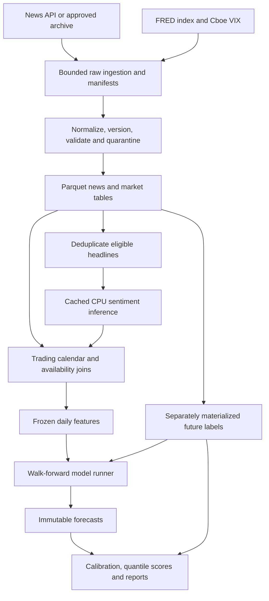

# Financial News and Daily Market VaR

## Project source of truth

**Version:** 1.1 · **Research date:** 15 September 2026 · **Status:** architecture baseline; data feasibility gate still open; core implementation started.

**Companion documents:** the [development plan](DEVELOPMENT_PLAN.md) adds agent execution stages and review requirements; [project status](PROJECT_STATUS.md) records actual progress. This blueprint remains the source of truth for system design and scientific decisions. The plan does not replace it.

**Owner:** project lead/developer. **Operating constraint:** this Windows laptop; free data first; at most 8 GB RAM for project work. **Deliverable:** a reproducible research dataset, defensible out-of-sample risk evaluation, and a small local batch system.

This document governs scope, definitions, data admission, implementation, experiments, acceptance criteria, and changes. Completed work includes public-source research, retained market/GDELT samples, a streaming audit of seven academic news files, an [executed feasibility notebook](notebooks/00_environment_and_sources.ipynb), versioned market/label persistence, and a bounded local FinBERT benchmark. The forecasting system, full source admission, sentiment feature pipeline, and predictive experiments remain to be implemented. Section 24 distinguishes delivered evidence from future work.

**How to interpret decisions:** `Accepted` means implement as specified. `Conditional` means the default is chosen, but a named empirical/access gate must pass. `Deferred` means outside the first release. Unknown data properties are not treated as facts. Closing a gate requires evidence, not changing its status by assertion.

## Contents

1. [Executive decision](#1-executive-decision)
2. [Evidence and hardware constraints](#2-evidence-and-hardware-constraints)
3. [Research question and scope](#3-research-question-and-scope)
4. [Research evidence and implications](#4-research-evidence-and-implications)
5. [Data sources and selection](#5-data-sources-and-selection)
6. [Data feasibility gate and acquisition](#6-data-feasibility-gate-and-acquisition)
7. [Time, availability, and target contract](#7-time-availability-and-target-contract)
8. [Architecture and technology decisions](#8-architecture-and-technology-decisions)
9. [Repository structure and module boundaries](#9-repository-structure-and-module-boundaries)
10. [Data contracts](#10-data-contracts)
11. [Cleaning and transformation rules](#11-cleaning-and-transformation-rules)
12. [Notebook research workflow](#12-notebook-research-workflow)
13. [Feature specifications](#13-feature-specifications)
14. [Sentiment inference](#14-sentiment-inference)
15. [Models and fitting](#15-models-and-fitting)
16. [Experiment protocol](#16-experiment-protocol)
17. [Evaluation and interpretation](#17-evaluation-and-interpretation)
18. [Resource budgets and performance gates](#18-resource-budgets-and-performance-gates)
19. [Reproducibility and operations](#19-reproducibility-and-operations)
20. [Verification and release requirements](#20-verification-and-release-requirements)
21. [Delivery plan and project management](#21-delivery-plan-and-project-management)
22. [Risk register and decision log](#22-risk-register-and-decision-log)
23. [Configuration baseline](#23-configuration-baseline)
24. [Immediate next actions and final acceptance](#24-immediate-next-actions-and-final-acceptance)
25. [Source register](#25-source-register)

## 1. Executive decision

**Recommendation: proceed with a short data feasibility stage. Do not yet commit to the claim that financial-news sentiment improves VaR.** The engineering and modeling fit the hardware budget. Reliable historical news availability is the critical dependency.

The first release will forecast the lower tail of the next trading session's **S&P 500 price-index close-to-close simple return**, using a clearly defined information cutoff. It will compare historical and volatility-based baselines with otherwise matched quantile regressions that add news counts and sentiment. The primary tail probability is **5%**, corresponding to **95% VaR**. The 1% tail is secondary because a few years of daily test data contain very few expected breaches.

The design deliberately includes four outcomes:

- **Positive research result:** news adds useful out-of-sample information under the documented data assumptions.
- **Negative research result:** the dataset and evaluation are sound, but news does not improve the strongest comparable baseline.
- **Qualified historical result:** publication/update metadata support a historical proxy experiment, but do not establish actual historical feed availability.
- **Data no-go:** usable historical text cannot be established within the access/resource gate; complete the market-risk project and, if feasible, a separately named GDELT tone/count experiment. Do not claim to have tested FinBERT on reliable historical news.

### Accepted first-release decisions

| Area | Decision |
|---|---|
| Instrument | S&P 500 price index from FRED; no constituent reconstruction |
| Forecast | Next-session close-to-close return, forecast before the starting close |
| Timing | Freeze inputs 30 minutes before scheduled close; issue by 15 minutes before close |
| Market information | Completed daily observations through the previous trading session, subject to availability |
| News candidate | Alpaca/Benzinga, conditional on free entitlement, history, version semantics, and permitted use |
| Public text alternative | GDELT archived page titles, conditional on affordable complete extraction; 2020–2025 protocol |
| Smaller public prototype | Audited Yahoo Finance academic collection; useful for engineering, insufficient for the preferred final test |
| Metadata fallback | GDELT tone/counts, explicitly a different experiment if archived text cannot be admitted |
| FNSPID | Exploration only until timestamp provenance passes; not the default |
| Representation | English headlines; frozen FinBERT probabilities; no article-body model in v1 |
| Storage | Immutable source payloads, Apache Arrow 25.0.1 Parquet tables, rebuildable DuckDB views/catalog |
| Modeling | Historical simulation, EWMA, GARCH-t/FHS, regularized linear quantile regression; one small tree challenger |
| Validation | Chronological development, monthly walk-forward refits, sealed final period |
| Platform | Python 3.12, Windows, CPU, sequential stages, maximum 8 GB project memory |
| Product | Local CLI and static research reports; scheduled local shadow forecasts only after validation |

A senior developer's first concern is whether the data contract can be satisfied. A senior PM's first concern is preventing three weeks of model development from depending on an unverified dataset. Both concerns are addressed by a five-working-day feasibility gate with a fallback path. Public evidence does not yet establish a clearly superior, turnkey free source. A free Alpaca news-access pilot is the most practical next access test; a paid subscription is not part of this plan. Work using the downloaded public samples can continue without credentials.

## 2. Evidence and hardware constraints

### 2.1 What was actually checked

On 15 September 2026, the workspace contained an empty Git repository and no application, notebooks, or existing project guidance. Read-only inspection found:

| Item | Observation | Design consequence |
|---|---|---|
| CPU | Intel Core i5-1340P; 16 logical processors visible | CPU execution; initially 2 computation threads, benchmark 4 |
| Installed RAM | 16,780,767,232 bytes, approximately 15.63 GiB | Installed capacity is not a usable process budget |
| Available RAM during inspection | Approximately 0.94–1.39 GiB | Do not start large inference/import jobs under the observed load |
| Later project RAM allowance | User permits up to 8 GB | Treat 8 GB as a ceiling; design for 2–4 GiB normal peaks |
| D: free storage | Approximately 71.02 GiB | Keep project artifacts below a planned 20 GiB; preserve 15 GiB free |
| Python | 3.12.2 installed | Use an isolated, patched Python 3.12 environment when implementation starts |
| GPU | Not verified; `nvidia-smi` not found on PATH | No GPU dependency or assumed CUDA acceleration |
| FinBERT CPU pilot | 1,000 titles: 47.60/s, 0.76 GiB peak RSS; 10,000 titles: 33.56/s, 0.90 GiB peak RSS | FP32 CPU path is viable; retain batch size 8 and four compute threads pending real-source work |
| Package manager | `uv` not found on PATH | Install during environment setup; no global package mixing |

Disk type and full-corpus throughput have not been measured. The benchmark used retained engineering-only titles and does not establish the runtime or domain coverage of an admitted news source. RAM availability changes as other applications run. The 8 GB allowance does not imply that a job can safely allocate 8 GB at startup. The resource gate in section 18 always checks currently available memory.

### 2.2 Public-source audit results

The initial probe read approximately 2.62 MB and retained diagnostics/hashes. It used bounded responses; both large news files returned HTTP 206 byte ranges. Follow-up collection retained small source snapshots under Git-ignored `data/`. These are direct observations from the [initial audit](docs/research/public_source_probe.json), [retained-sample audit](docs/research/retained_sample_audit.json), and [Yahoo collection audit](docs/research/yahoo_collection_audit.json).

| Probe | Result | Limitation |
|---|---|---|
| FRED SP500 CSV | 2,608 dated rows; 2,512 nonmissing values; 2016-09-15 through 2026-09-14 | Downloadable current history does not establish original publication latency or revisions |
| Cboe VIX CSV | 9,272 rows; 1990-01-02 through 2026-09-14; DATE/OHLC columns | Current historical file, not an intraday release log |
| FNSPID `All_external.csv`, first 1 MiB | 4,605 parsed rows, 5 symbols; 4,563 midnight timestamps, approximately 99.09% | Contiguous prefix; not a random sample or corpus-wide statistic |
| FNSPID `nasdaq_exteral_data.csv`, first 1 MiB | 153 parsed rows, 1 symbol; 152 midnight timestamps, approximately 99.35% | Contiguous prefix, all date strings in 2023; not representative |

All inspected FNSPID date strings carried a UTC suffix. That suffix does not establish genuine intraday precision. Midnight values may represent date-only information, a transformation artifact, or real midnight publication; they require provenance. Do not assume the whole corpus is bad, and do not assume these rows are safe.

The five retained GDELT intervals are individual 15-minute batches, not complete trading days:

| Batch, UTC | GKG rows | Rows with archived title | Rows in nine exploratory finance domains |
|---|---:|---:|---:|
| 2017-01-03 20:00 | 4,048 | 0 | 57 |
| 2020-03-16 20:00 | 2,830 | 2,817 | 48 |
| 2022-06-13 20:00 | 1,782 | 1,780 | 7 |
| 2023-03-13 20:00 | 1,685 | 1,684 | 23 |
| 2025-04-03 20:00 | 2,036 | 2,030 | 1 |

All inspected records had the expected 27-field layout and a parseable tone field. Each file used a single batch date value. The title observations agree with GDELT's documented September 2019 addition. The finance-domain counts are a warning against assuming today's short publisher list defines a stable historical universe; five selected batches cannot establish a coverage trend. Economic theme tags also occur in these files. [Official title documentation](https://blog.gdeltproject.org/unescaping-article-titles-in-the-gkg-2-0/).

All seven Yahoo research files were streamed, totaling **70,974 records and 105,919,076 compressed bytes**. This is the measured record count, not a unique-article count; it differs from the repository README's stated 51,272. No row lacked a title, but no row supplied a modification timestamp. There were 61 negative publication-to-crawl lags requiring quarantine/investigation. Early files contained only 403, 407, 1,588, and 1,855 records for 2017–2020; later files contained 20,706, 21,204, and 24,811 for 2021–2023. File coverage does not establish complete-news-feed coverage. See section 5.8.

Market inspection found VIX values for every nonmissing SP500 date, but also **27 extra VIX dates during 2022–2025** without an SP500 value. Join on verified exchange sessions, never row position. The notebook contains development-period return/volatility EDA for 2017–2022 only; final-period outcome performance was not inspected.

Total retained payloads are **155,055,491 bytes, approximately 147.87 MiB**, across 14 files. The FNSPID prefixes were not retained as raw files. No authenticated Alpaca request, complete-feed news audit, GPU benchmark, FinBERT inference, model fit, or backtest has been performed. End-to-end data feasibility remains conditional.

## 3. Research question and scope

### 3.1 Primary question

> Does financial-news sentiment available before a declared cutoff improve forecasts of the 5th percentile of the next-session S&P 500 price return, beyond the same model using lagged market data and news-volume controls?

There are two distinct comparisons:

1. **Any news contribution:** market + counts + sentiment versus market only.
2. **Sentiment contribution:** market + counts + sentiment versus market + counts. This is the primary attribution comparison.

The unit of statistical observation is a **forecast origin/trading session**, not an article. One million articles aggregated to 2,000 trading days still gives approximately 2,000 labeled examples. Millions of headlines do not justify a large downstream neural network.

### 3.2 Definitions

For adjacent exchange sessions `t` and `t+1`, let `C_t` be the official S&P 500 closing price-index value.

```text
target y_t = C_(t+1) / C_t - 1
q_(alpha,t) = predicted alpha-quantile of y_t given information available at cutoff_t
loss L_t = -y_t
VaR confidence = 1 - alpha
VaR loss fraction = -q_(alpha,t)
breach_(alpha,t) = 1[y_t < q_(alpha,t)]
```

Store returns and quantiles as decimal fractions. A stored quantile of `-0.02` means a 2% loss threshold. Internal model fitting may use percentage points (`100*y`), but adapters must return decimals. For an illustrative exposure `V`, dollar VaR is `V * (-q)`. This is a price-index risk illustration, not the measured P&L of an investable total-return portfolio.

**VaR is a loss quantile, not a maximum possible loss.** A breach label is defined relative to a particular issued forecast; there is no universal `target_VaR_breach` column to train before choosing a model. Fit return quantiles, then compute model-specific breaches.

Expected shortfall (ES) is the mean loss in the modeled tail. It is secondary and initially available only for models that specify a predictive distribution. Do not fabricate ES from a single VaR prediction.

### 3.3 In scope

- One U.S. market index, daily horizon, English financial headlines.
- Raw provenance, availability classes, revisions, deduplication, missing-feed detection, trading calendars, and dataset versions.
- Notebook EDA and exploratory cleaning before reusable pipeline code.
- Frozen sentiment inference and low-dimensional daily features.
- Chronological backtesting, calibration, comparative quantile scores, ablations, and uncertainty.
- CPU/memory benchmarks, restartable local runs, documented failure modes, and reproducible reports.

### 3.4 Deferred

Constituent portfolios, historical market-cap weights, multilingual news, full article bodies, paid feeds, intraday realized volatility, LLM-generated features, transformer fine-tuning, deep temporal fusion models, trading execution, portfolio optimization, dashboards, APIs, cloud deployment, and multi-user services.

Do not use today's S&P 500 constituents or market caps to reconstruct a historical news index. That would introduce survivorship or future information. Entity-aware extensions require effective-dated membership and weights known at each origin, including delisted names.

## 4. Research evidence and implications

### 4.1 Relevant evidence

- **Sentiment and equity tail risk:** a 2023 study reports improvements for S&P 500 VaR/ES when sentiment indices augment a realized-volatility model. Its richer inputs and model are motivation, not evidence that our headline features or free sources will work. The accessible publisher abstract supports this summary; its results were not independently reproduced. [Complete REGARCH-X study](https://www.sciencedirect.com/science/article/pii/S2110701723000719).
- **Text and macroeconomic tails:** Adämmer, Prüser, and Schüssler find incremental information in news-based predictors, particularly combinations of coverage and sentiment. Their targets are macroeconomic variables, not this project's daily index return. This motivates separating count effects from sentiment effects. [Forecasting macroeconomic tail risk in real time](https://www.sciencedirect.com/science/article/pii/S0169207024000463).
- **Small quantile models are credible:** research on parsimonious quantile forecasting uses volatility information at several horizons and reports competitive VaR behavior. This motivates a transparent linear baseline, without claiming to reproduce its realized-volatility specification. [HAR-QREG study](https://www.sciencedirect.com/science/article/abs/pii/S1544612315001385).
- **FinBERT is a sentiment model:** its original study evaluates financial-language classification. Sentiment classification performance does not demonstrate forecasting skill, and company-level positive language need not imply lower index tail risk. [Araci, 2019](https://arxiv.org/abs/1908.10063).
- **Risk models need both calibration and comparative evaluation:** a model can have plausible breach frequency yet poor forecast accuracy. Quantile scoring supports comparisons; ES requires joint treatment with VaR for appropriate comparative scoring. [Nolde and Ziegel](https://arxiv.org/abs/1608.05498), [Fissler, Ziegel, and Gneiting](https://arxiv.org/abs/1507.00244).

### 4.2 What the literature does not resolve

It does not settle our feed's historical availability, whether edited headlines are recoverable, whether news coverage is stable across years, or whether signal survives a strong volatility baseline. Those are empirical project questions. It also does not justify a causal statement that negative news causes tomorrow's loss. News can reflect market movements, common shocks, or changing publisher behavior.

**Design implication:** the research contribution is a transparent information contract and incremental forecast test. A careful negative finding remains a successful project. Avoid claims of novelty such as “the first FinBERT VaR system”; no exhaustive novelty review has established that.

## 5. Data sources and selection

### 5.1 Ranked news options

| Source | Evidence and access | Decision |
|---|---|---|
| Alpaca/Benzinga historical news | Official documentation describes history since 2015 and structured news fields | First candidate; authenticated pilot required |
| GDELT GKG archive | Archived titles since September 2019, plus themes/tone; title fields verified in four later samples | Public text alternative after a bounded complete-extraction/cost gate |
| Drinkall et al. Yahoo Finance collection | Seven original public files fully inspected; 70,974 records, publication and crawl times | Accepted for bounded engineering EDA; not admitted as the main complete feed |
| FNSPID | Large downloadable corpus; our prefixes show mostly midnight timestamps | Timestamp audit only; not accepted for primary intraday ordering |
| Alpha Vantage NEWS_SENTIMENT | Date-range queries and up to 1,000 results documented | Secondary source feasibility candidate; history/completeness/entitlement must be proved |
| NewsAPI Developer | Short free history and delayed articles | Reject for multi-year historical research |
| Academic Reuters/Bloomberg-derived collections | Potential value if an institution already grants suitable access | No dependency without a specific licensed dataset and schema |
| Unverified Kaggle mirrors | Hosting and a timestamp column do not establish provenance | Discovery only; require original source and rights |
| RSS collected from now onward | Can support actual observed-availability logs | Prospective engineering validation; insufficient history for the main backtest |

### 5.2 Alpaca/Benzinga: conditional primary

Use the historical news REST endpoint at `https://data.alpaca.markets/v1beta1/news`. The documented schema includes article ID, headline, timestamps, URL, and symbols. The reference specifies a maximum page size of 50, inclusive start/end bounds, and sorting by update time. Those semantics make pagination and revisions part of the data contract. [Historical news overview](https://docs.alpaca.markets/us/docs/historical-news-data), [endpoint reference](https://docs.alpaca.markets/us/reference/news-3), [news schema](https://docs.alpaca.markets/us/docs/streaming-real-time-news).

The current market-data page documents a free Basic account and equity-data limits, but that alone does not prove the required news entitlement. The 2022 news launch described a limited-time free beta; it is not reliable evidence of today's permanent pricing. **Budget remains zero unless the user changes it.** Test actual historical news access and permitted research/storage use before selecting the provider. [Current market-data plans](https://docs.alpaca.markets/us/docs/about-market-data-api), [dated launch announcement](https://alpaca.markets/blog/introducing-news-api-for-real-time-fiancial-news/).

Initial source universe: all articles returned by the chosen financial-news feed, queried without a current constituent list. Request headline/metadata only (`include_content=false`), then apply the frozen language and relevance policy in section 11. Do not silently use the provider's symbol coverage as proof of a complete U.S. equity universe.

**Critical limitation:** a latest-version historical API is not necessarily a point-in-time archive. An article created on Monday and edited on Wednesday cannot have its Wednesday wording assigned to Monday. Use the availability-class rules in section 7. If the API exposes no version history, the historical experiment remains a qualified reconstruction.

**Free-tier operating plan:** the Basic equity-data page currently lists 200 historical API calls/minute and a recent-data restriction. Those stock-data figures do not establish this account's news quota. The news endpoint itself documents delayed defaults for accounts without real-time access and rate-limit response headers. Start at 30 requests/minute, one request in flight; after verification use at most `min(60, floor(0.5 * verified_news_requests_per_minute))`. Respect any stricter daily quota, entitlement delay, and `Retry-After`. Initial access probe: at most 100 requests; admitted resumable backfill: at most 1,000 requests per invocation. These are local safety/cost controls, not invented provider limits. A 401/403 stops the access test; it does not trigger an upgrade.

At 50 articles/page, 500,000 article records require at least 10,000 pages: approximately 5.6 hours at 30 requests/minute or 2.8 hours at 60, excluding retries, interval-edge overhead, and incomplete pages. Actual article volume and entitlements must be measured. Fetch historical dates outside the account's recent-data delay. Cache all committed pages so EDA/model reruns consume no API calls. No trading endpoint is needed. [News endpoint limits](https://docs.alpaca.markets/us/reference/news-3), [Basic equity plan](https://docs.alpaca.markets/us/docs/about-market-data-api).

### 5.3 FNSPID: useful evidence, wrong default

The original project advertises 1999–2023 coverage and millions of records. Those headline totals are not an audited count of independent articles or historical index membership. The Hugging Face news directory lists approximately 5.73 GB and 23.2 GB CSV files. Downloading and loading them into pandas would be a poor first action on this laptop. [Original repository](https://github.com/Zdong104/FNSPID_Financial_News_Dataset), [file inventory](https://huggingface.co/datasets/Zihan1004/FNSPID/tree/main/Stock_news).

The inspected preview has a schema-generation error, and our direct prefix audit found a strong midnight concentration. Neither proves every observation is unusable. Both require a source-stratified audit before any predictive claim. The licensing material also conflicts: a July 2025 README note broadens use, while the license file remains CC BY-NC 4.0 and older restrictive wording remains in the README. Do not infer publisher-content redistribution rights from a repository license. [Dataset preview](https://huggingface.co/datasets/Zihan1004/FNSPID), [license file](https://github.com/Zdong104/FNSPID_Financial_News_Dataset/blob/main/LICENSE).

Admission would require documented timestamp-generation logic, source examples corroborating time zones, distinction between date-only and timed rows, and enough valid overlap after filtering. Never “repair” midnight to market open, infer time from headline wording, or globally shift hours until the backtest improves. A date-only sensitivity study can be defined later, but is not a substitute for the primary timestamped study.

### 5.4 GDELT: public archived titles and metadata

GKG stores extracted page titles in `Extras` under `PAGE_TITLE` from September 2019 onward. We verified actual archived title presence in the selected 2020, 2022, 2023, and 2025 files. Extract this field, HTML-unescape locally, and retain the raw batch/hash. This can support a **GDELT-title + FinBERT** experiment; it is more than a tone-only fallback. A page title still needs cleaning and source-quality checks and need not equal an editorial headline. Do not fetch today's article at an old URL and substitute its current text. [Title-field introduction](https://blog.gdeltproject.org/gkg-2-0-now-includes-page-titles/), [title extraction](https://blog.gdeltproject.org/unescaping-article-titles-in-the-gkg-2-0/).

The GKG record ID encodes a 15-minute batch. The codebook describes `V2.1DATE` as publication-related but also says it is the same across rows in a file. Treat the archive batch as the operational proxy; do not equate it with verified publisher time. Inspect archive-release behavior and preserve that limitation. GDELT's current DOC search endpoint is not the assumed mechanism for an exhaustive multi-year backfill. [GKG codebook](https://data.gdeltproject.org/documentation/GDELT-Global_Knowledge_Graph_Codebook-V2.1.pdf), [GDELT DOC documentation](https://blog.gdeltproject.org/gdelt-doc-2-0-api-debuts/).

A full local GKG archive is rejected. At the mean compressed size of our five batches, six years would imply about **1.86 TiB** of transfer. That is an illustrative scenario, not a representative archive estimate; it is enough to reject blind bulk download on this laptop. A bounded September 2026 public catalog check independently listed all 96 quarter-hour batches for each of 2020-03-16 and 2022-06-13, at 759.2 MB and 494.8 MB compressed respectively; it supports the same local-storage decision but does not establish title eligibility. The [dated catalog evidence](docs/research/gdelt_catalog_pilot_20260916.json) retained 26 capped ranges (1.70 MB total), never the 127.7 MB mutable master list. Sampled rows/files cannot be substituted for complete daily news counts.

Next extraction spike: at most two focused hours to use the prepared [schema query](docs/research/gdelt_bigquery_schema.sql) and [one-day count-only dry-run query](docs/research/gdelt_bigquery_day_summary.sql) against the partitioned public table `gdelt-bq.gdeltv2.gkg_partitioned`. First audit the current schema, then use explicit `_PARTITIONTIME` bounds, a `DATE` parameter and only required columns. Each first-pilot dry run and execution has a 10 GiB maximum-byte cap; do not execute a query whose dry-run estimate exceeds it. The [pilot contract](docs/development/m0_gdelt_pilot_contract.md) predeclares 2020-03-16 and 2022-06-13 and the evidence to retain. Filter relevance using development-inspected economic themes and documented publisher rules only after that count/metadata gate; a filter after scanning does not necessarily reduce bytes charged. A later title export must retain original title, document URL, batch/record identifiers, source, translation metadata, theme and tone fields, with HTML decoding local. An initial candidate filter uses whole theme codes `ECON_STOCKMARKET`, `ECON_INTEREST_RATES`, `ECON_INFLATION`, and `ECON_CENTRALBANK`; verify actual tag meanings/coverage and U.S. relevance before freezing it. These are candidates, not an already admitted universe.

Use BigQuery's no-billing sandbox only if access is available, with dry runs and `maximum_bytes_billed`. The documented sandbox includes 1 TiB monthly query processing, 10 GiB storage, and 60-day expiration; it is not durable project storage. Local project limits: 10 GiB estimated scan for the first executed pilot, 100 MiB downloaded results initially, and an 800 GiB total monthly scan plan leaving headroom under the shared free allowance. If the full extraction cannot fit the free budget/timebox, stop this route; do not enable billing or present domain filtering as a cost guarantee. No cloud account creation or query has been performed. [BigQuery sandbox](https://docs.cloud.google.com/bigquery/docs/sandbox), [cost controls](https://docs.cloud.google.com/bigquery/docs/best-practices-costs).

GDELT describes its datasets as available without access fees for varied uses; retain attribution and source links. That statement does not settle redistribution of complete publisher article bodies. [GDELT access terms](https://gdeltproject.org/about.html). If titles cannot be admitted but tone/counts can, name the fallback **GDELT metadata VaR** and replace the sentiment feature schema; do not label vendor tone as FinBERT output. A metadata-only extraction may still have a large scan cost.

### 5.5 Other APIs

Alpha Vantage supports `NEWS_SENTIMENT` time ranges and a result limit up to 1,000; if a time slice reaches the cap, split it recursively until completeness can be established. Do not infer earliest historical coverage from an example date. Its general free allowance is documented as 25 calls/day; endpoint and educational entitlements require verification. Vendor sentiment would be a separately named feature, not FinBERT output. [API documentation](https://www.alphavantage.co/documentation/), [usage limits](https://www.alphavantage.co/support/).

NewsAPI's free Developer plan currently provides one month of searchable history with a 24-hour delay and development-only terms. It cannot support the planned multi-year study. [NewsAPI pricing and plan conditions](https://newsapi.org/pricing).

### 5.6 Market data

**Primary:** FRED `SP500`, fetched as CSV from `https://fred.stlouisfed.org/graph/fredgraph.csv?id=SP500`. This is a price index excluding dividends. FRED provides a rolling ten-year daily history and marks reproduction restrictions; maintain a private dated snapshot where permitted and publish loaders, manifests, synthetic fixtures, and permitted results. A future fresh download may not contain the same early dates. [FRED series notes](https://fred.stlouisfed.org/series/SP500).

**Volatility control:** Cboe's daily VIX CSV at `https://cdn.cboe.com/api/global/us_indices/daily_prices/VIX_History.csv`; FRED `VIXCLS` is a cross-check. Use prior-session VIX only, subject to actual/assumed availability. The daily close is not guaranteed to have been retrievable at its nominal observation time. VIX is option-implied volatility, not realized volatility. [Cboe historical data](https://www.cboe.com/tradable-products/vix/vix-historical-data), [FRED VIX](https://fred.stlouisfed.org/series/VIXCLS).

**Excluded from v1:** SPY/yfinance/Stooq substitution, OHLCV enrichment, and individual equities. An ETF is not identical to the index: dividends, fees, corporate actions, and adjusted-price vintages alter the target. FRED SP500 has no OHLCV; leave those features out rather than inventing or silently mixing sources. If the target source becomes unavailable, make an explicit target-change decision and rerun the study.

**Implemented source-quality boundary:** the dated September 2026 private snapshots are admitted by byte count, SHA-256, exact CSV schema, unique date, positive finite observed close and retained-audit row counts before session matching. The 2016-09-15–2025-12-31 frozen XNYS grid has 2,337 sessions, with a valid FRED close and Cboe VIX close on every session. FRED has 88 placeholders in that requested date range, all on non-session dates. Cboe has 27 extra 2022–2025 rows on XNYS closures, including the 2025-01-09 special closure; these are excluded from forecast origins and index labels. The [dated coverage report](docs/research/market_coverage_20260916.json) contains source lineage and every excluded date. This verifies source quality/date coverage only; it does not prove original market-data availability, news admission, or usable forecast-label counts.

### 5.7 Rights and publication

Maintain a source-level record of retrieval terms, research use, local retention, transformation, and redistribution. Code, model weights, data, and derived artifacts can have different rights. No news text, raw price series, or pretrained weights go into Git by default. A public dataset release is a separate deliverable requiring documented rights. Read-only research and the private audit do not imply authorization to republish source content.

### 5.8 Yahoo Finance academic collection: useful prototype, limited study base

Use the original [Drinkall et al. dataset repository](https://github.com/FelixDrinkall/financial-news-dataset), not a harmonized mirror's date fields. Its schema documents publication and initial Common Crawl download times as UTC and declares CC BY-NC-SA 4.0. The [associated research](https://arxiv.org/abs/2502.02199) concerns noisy regression and representation size; it does not validate our daily VaR design.

| Publication-year file | Records inspected | Distinct publication dates | Median crawl lag, hours | Negative crawl lags |
|---|---:|---:|---:|---:|
| 2017 | 403 | 195 | 7.96 | 0 |
| 2018 | 407 | 151 | 2.00 | 6 |
| 2019 | 1,588 | 223 | 1.20 | 7 |
| 2020 | 1,855 | 177 | 1.10 | 11 |
| 2021 | 20,706 | 324 | 0.73 | 0 |
| 2022 | 21,204 | 295 | 0.77 | 0 |
| 2023 | 24,811 | 329 | 0.83 | 37 |

These are file-wide diagnostics from our [streaming inspection](docs/research/yahoo_collection_audit.json). Some crawls occur days or years after publication; assign by validated crawl/version availability, never publication alone. Investigate negative lags and null modification metadata against original archive evidence. Do not silently adjust the timezone to make the lags positive.

**Accepted use now:** parser development, timestamp/deduplication EDA, bounded headline inspection, and sentiment throughput/domain benchmarking once memory permits. Import an explicit allowlist of original text, URL, publisher, language, publication/crawl/modification fields. Discard supplied current/previous/next-day stock prices, sentiment, emotion, entities, related companies, and derived labels at the adapter boundary. Those fields are unnecessary and may encode future information or modern entity mappings. Also audit how records were selected; dropping future-price columns does not remove selection bias if their availability determined inclusion.

**Not admitted for the primary result:** incomplete/uneven crawl coverage, a substantial early/late volume break, unresolved version provenance, and no publication-year files for 2024–2025. A completed file download is not a completed feed interval, and an empty day is not proven zero news. A separate sampled-corpus demonstration is possible, but cannot inherit the main feed-completeness claim or final split. Do not splice Yahoo into Alpaca/GDELT gaps to manufacture a continuous series.

### 5.9 Binding source-selection rule

1. Preserve the audited public files and finish source/calendar engineering with them.
2. Give GDELT the bounded extraction spike above. Admit it if complete daily windows, stable relevance, archival semantics, and a zero-cost extraction plan pass; use the explicit 2020–2025 protocol in section 16.
3. If GDELT cannot satisfy that gate, use the user's offered **free Alpaca account** for a small news-entitlement pilot. If it passes, use Alpaca as the operational source and the preferred longer-history protocol. If both sources pass, prefer Alpaca for the first local daily system unless the pilot reveals worse temporal/version integrity; record that evidence-based override before model evaluation.
4. If neither passes within the five-day gate, finish market-only VaR and the public-data prototype. A GDELT tone-only study needs its own successful extraction/coverage gate.

No source is chosen based on which produces the most favorable test return relationship. The present recommendation for an Alpaca pilot reflects extraction simplicity and potential longer coverage, not a claim that its free news access has already been verified.

## 6. Data feasibility gate and acquisition

### 6.1 Five-working-day gate

The gate is timeboxed to about 20–30 focused hours. Its outputs are an audit notebook, source admission record, estimated full-run cost, and a go/no-go decision. A missing credential is an access dependency; work on calendar tests and market-only EDA can continue while it is resolved.

1. Verify account/endpoint access, licensing scope, pagination, response schema, and timestamp meanings.
2. Fetch one normal week and one high-news-volume week. Check repeated requests and interval boundaries.
3. Audit at least one calendar week per year of proposed coverage, plus stress periods and a DST/early-close boundary. Sampling is for feasibility, not the final dataset.
4. Estimate exact article counts, byte volume, and post-filter coverage from complete queried intervals; never extrapolate from one ticker prefix as if it were representative.
5. Benchmark parsing and 1,000 unique headline inferences after the resource gate passes.
6. Record the selected source, availability class, viable date interval, and any scope reduction before full ingestion.

### 6.2 Admission criteria

These thresholds are project engineering defaults, not standards from the literature. Freeze any revision before model-performance inspection.

| Requirement | Acceptance rule |
|---|---|
| Use rights | Intended local research and retention documented; redistribution separately classified |
| API completeness | All page tokens exhausted; bounded intervals reconcile; no unexplained result caps |
| Timestamps | 100% of admitted records parse to UTC with documented precision/semantics |
| Text version | Every admitted payload has a declared version-time policy; edited text is never backdated |
| Manual audit | At least 100 records stratified by source/year/boundary; any unexplained systematic timezone error blocks the affected stratum |
| Historical overlap | Preferred 2017–2025; minimum 1,250 usable origin rows after warmup and exclusions |
| Primary final test | At least 500 common eligible forecasts; preferred approximately 750 |
| Feed continuity | At least 95% of expected windows complete overall and 90% in each calendar year; no unexplained gap exceeding 5 sessions |
| FinBERT coverage | At least 98% of otherwise eligible retained headlines scored per included session |
| Resource feasibility | Project peak below 6 GiB target, never above the 8 GB allowance; full-run estimate within section 18 |

A legitimately empty, fully queried feed interval counts as complete; an API failure does not. “At least one headline every day” is not an admission requirement. A material source change can require separate eras even when the numeric continuity threshold passes.

If the preferred date range fails, freeze the earliest contiguous qualifying interval based on data quality alone. With 1,250–1,999 usable rows, reserve the last 500 for testing, the preceding 250 for validation, and at least 500 earlier rows for training. This is a reduced-power study. Fewer than 1,250 rows means descriptive/prototype work, not the planned confirmatory forecast study. The historical FinBERT snapshot must still predate scored validation/test origins.

### 6.3 Acquisition protocol

- Use a small HTTP adapter with explicit timeouts, retries for transient errors, exponential backoff with jitter, and `Retry-After` support. Default one request in flight; initial Alpaca throttle 30 requests/minute, subject to stricter verified limits. Increase only under section 5.2.
- For Alpaca, begin with calendar-day UTC chunks, `limit=50`, `sort=asc`, and `include_content=false`; save every response page. Map to exchange sessions only after normalization.
- Confirm whether interval filters apply to created or updated times using the pilot; do not assume sorting defines filtering. Query semantics are recorded in the adapter version and source manifest.
- Because endpoint bounds are inclusive, overlap adjacent chunks intentionally and deduplicate by version keys. Do not advance an interval simply because the last page was full.
- Persist the page cursor only after the raw page and manifest are committed. On interruption, replay safely. Detect repeated cursors and duplicate-page loops.
- For prospective refresh, re-query a 7-calendar-day overlap and append newly observed versions. This detects some late updates; it does not establish completeness for older revisions. Never overwrite a prior forecast's inputs.
- Preserve source payload hashes, response status, interval, safe response headers, retrieval time, parser version, and row counts. Redact credentials and query secrets from logs.
- Write temporary files inside the destination filesystem, flush, then atomically rename after validation. The manifest exposes only committed files.
- No bulk scrape of publisher bodies, automatic paid subscription, or all-symbol market-price download is needed.

## 7. Time, availability, and target contract

### 7.1 Why the original end-of-day description needs refinement

The tempting design is “use today's final close and today's news, then forecast tomorrow's close-to-close return.” A daily close generally becomes retrievable after the closing instant. If the forecast also uses news from 16:30, but the target begins at 16:00, part of the risk period has already occurred.

**Accepted conservative profile:** use daily market data through `t-1`, freeze news before close `t`, and issue the forecast before close `t`. This preserves a completely future close-to-close target without requiring intraday prices. The cost is less current structured market information. News may therefore help partly by describing today's market movement; the interpretation and ablations must acknowledge that.

The primary result is specifically **pre-close forecasting with lagged daily market inputs**, not an idealized zero-latency end-of-day model. A later intraday-market baseline can test whether news adds information beyond current prices, but requires a separate data gate.

### 7.2 One authoritative calendar

Use `exchange_calendars` with `XNYS` to generate the U.S. cash-market session schedule, and verify relevant closures/early closes against exchange notices. Store the resulting schedule snapshot and package version. Use `America/New_York` for market definitions, UTC for stored timestamps, and `Asia/Ho_Chi_Minh` only for local display. Never use naive local datetimes, fixed UTC offsets, calendar-day shifts, or pandas business-day defaults as an exchange calendar. [Calendar library](https://github.com/gerrymanoim/exchange_calendars), [NYSE hours and holidays](https://www.nyse.com/markets/hours-calendars).

**Implemented calendar foundation:** [XNYS origin contract](docs/development/m1_calendar_contract.md) is pinned to `exchange_calendars==4.13.2` in `uv.lock`. A dated 2016-09-15–2025-12-31 snapshot was built and reloaded with calendar ID `0fa86aa24e4551cc2346bb00b069a3e733797edd35bfa87d8440bdff7e345b9c` and 2,337 exchange-session origins; the 816,013-byte file is retained privately under Git-ignored `data/calendars/`. Cutoff, issue, previous/next session, window boundaries and target timestamps are hashed with package/tzdata versions. Source-date matching and fixture labels now use this frozen identity; full normalized persistence and right-edge calendar extension remain separate tasks. A future package/exchange correction gets a new calendar/dataset version, not an edit to this snapshot.

For each session `t`:

```text
close_ts[t]       = scheduled cash-market close in UTC
cutoff_ts[t]      = close_ts[t] - 30 minutes
issue_deadline[t] = close_ts[t] - 15 minutes
news_window[t]    = (cutoff_ts[previous_session(t)], cutoff_ts[t]]
target_start[t]   = close_ts[t]
target_end[t]     = close_ts[next_session(t)]
market_last_session[t] = previous_session(t)
```

Regular-session New York times are 15:30 freeze and 15:45 issue; an early 13:00 close gives 12:30 and 12:45. During U.S. daylight saving time, a regular 15:30 cutoff is 02:30 the next calendar day in Vietnam; in winter it is 03:30. Compute conversions from time zones rather than scheduling a fixed Vietnam hour.

### 7.3 Availability classes

**Class A — observed/versioned availability.** An immutable historical or prospective record establishes when this exact payload was delivered or observed. `available_at` is the later of documented payload-release time and first successful receipt, with any known provider entitlement delay respected. A vendor archive with credible historical dissemination timestamps can qualify; mere publication time cannot.

For a historical versioned replay, the receipt/dissemination evidence must itself be historical; our 2026 backfill receipt is a different field. For a prospective forecast, receipt means the actual local receipt. A historical release log is not proof that this laptop had access then; name the information-access assumption in the study mode.

**Class B — reconstructed historical availability.** The source supplies credible publication/update metadata but no historical delivery/version log. For the exact payload returned by a latest-version API:

```text
version_time = max(created_at, updated_at)  # when updated_at exists and is trustworthy
available_at_proxy = version_time + max(15 minutes, documented entitlement delay)
```

The 15-minute buffer is an assumed minimum latency, not proof. If an update occurred after a historical cutoff, that payload is ineligible at that cutoff. Assign it only from its update-time proxy onward; do not reconstruct unavailable earlier wording. If created/updated field semantics are untrustworthy, downgrade to Class C. Label all Class B results as historical proxy results and run delay sensitivities.

For GDELT, use the archived batch time plus the chosen release-latency buffer for the exact title preserved in that batch. This is Class B until historical archive-release evidence supports a stronger claim. For the Yahoo academic files, a validated original crawl time can bound when the captured payload existed; the present derivative file's crawl field alone does not certify when a usable feed delivered it. Preserve `archive_observed_at_utc` separately from our 2026 retrieval time. Neither adapter invents missing editorial creation/update times.

**Class C — inadequate chronology.** Date-only records, undocumented time zones, inconsistent update fields, or unrecoverable timestamp transformations are excluded from the primary experiment. Keep a quarantine reason. A lagged date-only experiment may later be descriptive, with a separate protocol.

`retrieved_at` is the real download time, even for a 2017 backfill. Do not set it to 2017. Retrospective research may use a justified Class B proxy despite retrieval in 2026; prospective evaluation must use actual observation times. Keep separate `availability_basis` and `study_mode` fields so the two claims cannot be mixed.

### 7.4 Market data availability

For historical FRED/Cboe snapshots, using session `t-1` at cutoff `t` is a declared prior-session availability assumption, not a certified original vintage. Archive observed releases during prospective operation. At runtime require the actual usable daily value to have been received by the cutoff; a delayed value is missing, not backfilled into an issued forecast.

The main profile requires market inputs through exactly `t-1`. If they are stale, do not silently use `t-2` while calling it the same model. Record a missing forecast or invoke a separately validated stale-data profile with its own ID. VIX availability is assessed independently of index prices. Delayed or revised source values never overwrite the stored feature row used for an issued prediction.

### 7.5 Concrete alignment examples

| Observation | Assignment |
|---|---|
| Headline becomes eligible at Monday 15:29 NY | Included in Monday's window; forecast concerns Monday close to Tuesday close |
| Headline becomes eligible at Monday 15:31 NY | First eligible in Tuesday's window; cannot change Monday's forecast |
| Friday-after-cutoff or weekend headline | Included in Monday's window, or the next session after a Monday holiday |
| Weekend headline after a Friday forecast | Cannot be used retrospectively to improve the forecast for Friday-close-to-Monday-close |
| Monday-created headline updated Wednesday | Wednesday wording never enters Monday's feature vector |
| Prior-session bar downloaded after today's cutoff | Not available for today's prospective forecast |

Boundaries use availability time, not merely the displayed publication time. An item exactly at the upper cutoff is eligible; the lower boundary is open, so an item is assigned once.

### 7.6 Temporal invariants

For every issued forecast, prove:

1. `max(input_available_at) <= cutoff_ts < issue_deadline < target_start < target_end`.
2. The artifact used for prediction exists by its issue deadline in prospective mode.
3. Every training label was observable by the refit cutoff. Before close `t`, `y_(t-1)` is not yet observed; with prior-session market availability, the newest fully labeled origin is normally `t-2`.
4. All scalers, feature selection, tuning, and model parameters use only eligible training information.
5. Adding or modifying future records cannot change an earlier frozen feature row or forecast.
6. A replay of a historical proxy is never relabeled as an actually issued historical prediction.

The last-observed market return is `r_(t-1)`, while the target is `r_(t+1)`. Consequently volatility-model forecasting is **two steps ahead from the market data state**, even though the target holding period is one session. Section 15 specifies how to avoid accidentally forecasting `r_t` or a two-day cumulative return.

## 8. Architecture and technology decisions

### 8.1 Architecture



The core flow is an ordinary local Python package invoked by a CLI. Each stage reads committed inputs and writes a new versioned artifact. Notebooks call the same functions once exploratory logic is promoted. DuckDB queries Parquet directly and provides SQL-based quality checks; it is rebuildable rather than the sole copy of the data.

### 8.2 Technology choices

| Concern | Selected technology | Reason / rejected alternative |
|---|---|---|
| Runtime | Python 3.12, patched and isolated | Existing environment and numerical/NLP ecosystem; no simultaneous Conda/uv stacks |
| Dependencies | `uv`, `pyproject.toml`, committed `uv.lock` | Reproducible resolution and separate dependency groups |
| Bulk storage | Parquet through PyArrow, Zstandard compression | Column selection and batch processing; CSV retained only when it is the original source |
| Analytical queries | DuckDB | Local SQL, direct Parquet access, disk spilling; PostgreSQL adds an unnecessary service |
| Small tables/EDA | pandas, NumPy | Daily modeling matrix is small; never materialize the full text corpus |
| HTTP | HTTPX plus explicit retry policy | Small transparent adapters; SDK optional only if it demonstrably reduces complexity |
| Contracts/config | PyArrow schemas, Pydantic settings, safe YAML | Explicit types and validated defaults; no heavy feature-store framework |
| Calendar | `exchange_calendars`, `zoneinfo`, `tzdata` | Exchange sessions and Windows time-zone support |
| Sentiment | Hugging Face Transformers + CPU PyTorch | One frozen model; ONNX Runtime dynamic INT8 only after equivalence/performance tests |
| Risk models | scikit-learn, `arch`, SciPy | Mature small-model implementations; no custom transformer predictor |
| EDA | JupyterLab + Jupytext + nbconvert | Inspectable notebooks with clean reruns and readable source diffs |
| Figures | Matplotlib, optional Seaborn | Deterministic exportable research figures |
| CLI | Typer | Clear stage commands and validated arguments |
| Verification | pytest, Hypothesis, Ruff, mypy for core contracts | Focus on time/data/model boundaries |
| Runs | JSON manifests and Parquet metrics | Adequate local experiment ledger; MLflow deferred until multiple users or many runs require it |
| Scheduling | Manual CLI initially; Windows Task Scheduler later | No resident workflow stack; tasks run only when machine is awake |

Resolve exact package versions in the environment spike, test Windows wheels and the selected model loader, then freeze the lockfile. This document specifies the version-selection procedure rather than inventing an untested set of compatible package pins. `uv sync --locked` must fail when the declared dependencies and lockfile disagree. [uv locking](https://docs.astral.sh/uv/concepts/projects/sync/).

**Not selected:** Spark, Kafka, Airflow, Kubernetes, Redis, vector databases, PostgreSQL, Feast, DVC, and cloud inference. None is necessary for a single daily index and a locally cached text corpus. Reconsider only against a measured requirement: multiple simultaneous writers, multiple users, unavoidable remote data volume, or a demonstrated operational bottleneck.

## 9. Repository structure and module boundaries

The following is the **target implementation layout**. The blueprint, research artifacts, and notebook 00 are delivered. A minimal packaged core, locked development environment, resource-doctor CLI and its tests now exist; the ingestion/modeling pipeline and other components below remain planned. Consult [project status](PROJECT_STATUS.md) for current capability evidence. Create components when their phase starts; empty infrastructure directories are not progress.

```text
VaR Financial News/
  README.md                         # entry point; points to this specification
  PROJECT_BLUEPRINT.md               # authoritative decisions and change history
  pyproject.toml
  uv.lock
  .python-version
  .env.example                      # names only, no credentials
  .gitignore
  configs/
    base.yaml                       # validated defaults from section 23
    sources.yaml                    # source IDs, access policy, approved intervals
    experiments/
      primary_95.yaml
      exploratory_99.yaml
      gdelt_fallback.yaml            # only if the fallback gate passes
      gdelt_titles.yaml              # separate 2020–2025 text protocol
  src/newsvar/
    cli.py
    settings.py
    contracts.py                    # Arrow schemas, enums, validators
    calendar.py                     # session schedule and UTC cutoffs
    provenance.py                   # IDs, hashes, manifests, commit protocol
    ingestion/
      http.py                       # shared bounded request/retry behavior
      alpaca_news.py
      market.py                    # implemented bounded FRED/Cboe snapshot parser/date audit
      fred.py                      # future provider/vintage adapter if needed
      cboe.py                      # future provider/vintage adapter if needed
      gdelt.py                      # conditional, separate adapter
    cleaning/
      timestamps.py
      headlines.py
      deduplication.py
      quality.py
    nlp/
      finbert.py
      cache.py
      benchmark.py
    features/
      market.py
      news.py
      alignment.py
      build.py
    labels.py                       # future returns; not imported by feature builders
    models/
      base.py                       # common fit/predict contract
      historical.py
      ewma.py
      garch.py
      quantile.py
    backtesting/
      splits.py
      walk_forward.py
      metrics.py
      coverage.py
      comparisons.py
    reporting/
      figures.py
      report.py
    pipeline.py                     # small stage dependency graph
  notebooks/
    00_environment_and_sources.ipynb
    01_timestamp_and_coverage_audit.ipynb
    02_market_eda.ipynb
    03_news_eda_and_cleaning.ipynb
    04_alignment_and_leakage_audit.ipynb
    05_sentiment_validation.ipynb
    06_baseline_risk_models.ipynb
    07_development_experiments.ipynb
    08_locked_test_report.ipynb
    *.py                            # paired Jupytext percent-format sources
  tests/
    unit/
    integration/
    temporal/
    statistical/
    fixtures/                       # synthetic or explicitly redistributable data
  scripts/
    run_daily.ps1
    profile_resources.py
  docs/research/
    probe_public_sources.py         # delivered: bounded feasibility probe
    public_source_probe.json        # delivered: observed diagnostics
    collect_feasibility_sample.py   # delivered: bounded FRED/Cboe/GKG snapshots
    retained_sample_audit.json      # delivered: snapshot hashes and diagnostics
    audit_yahoo_collection.py       # delivered: streaming original-source audit
    yahoo_collection_audit.json     # delivered: all seven files inspected
    build_audit_notebook.py         # delivered: authors notebook 00
    inspect_model_revision.py       # delivered: metadata-only checkpoint resolution
    finbert_revision_audit.json     # delivered: historical full SHA and file inventory
    record_environment.py           # delivered: records audit dependencies
    execution_environment.json      # delivered: observed package versions
  data/                             # ignored by Git
    raw/<provider>/<ingestion_run>/
    normalized/<dataset_version>/
    quarantine/<dataset_version>/
    sentiment/<model_fingerprint>/
    features/<dataset_version>/
    labels/<dataset_version>/
    calendars/<calendar_version>/
    manifests/
    catalog.duckdb                  # rebuildable, one writer
  artifacts/                        # ignored; publish selected permitted reports
    models/<model_run_id>/
    runs/<run_id>/
    forecasts/<forecast_run_id>/
    reports/<report_id>/
  .cache/                           # ignored; model downloads and bounded spill
  .github/workflows/ci.yml           # fixture-only checks; no secret news downloads
```

### 9.1 Dependency rules

- Adapters return raw pages and manifests. They do not compute sentiment or targets.
- Cleaning parses source records without consulting market outcomes.
- Feature functions accept a cutoff and eligible normalized inputs. They cannot import `labels.py` or read label paths.
- Model adapters accept explicit training rows and return typed forecasts. They do not fetch data.
- The backtester controls chronology and model refits; it does not hide feature engineering inside a notebook cell.
- Reporting reads frozen predictions and separately joins outcomes. It never changes predictions.
- All filesystem paths come from the configured project root through `pathlib`; no hard-coded user directory or notebook `chdir` dependency.

### 9.2 Planned CLI contract

These commands specify the intended interface; they are not available yet.

```powershell
uv run newsvar doctor
uv run newsvar sources audit --source alpaca --config configs/sources.yaml
uv run newsvar ingest --source alpaca --start 2017-01-01 --end 2017-01-31
uv run newsvar normalize --ingestion-run <id>
uv run newsvar sentiment --dataset <id> --profile cpu
uv run newsvar features --dataset <id> --profile preclose_v1
uv run newsvar labels --dataset <id>
uv run newsvar backtest --config configs/experiments/primary_95.yaml --split development
uv run newsvar backtest --config configs/experiments/primary_95.yaml --split locked-test
uv run newsvar report --run <id>
uv run newsvar forecast --session 2026-10-01 --mode prospective
```

CLI exit codes: `0` success; `2` invalid configuration; `3` unmet data/resource gate; `4` transient ingestion failure after retries; `5` invariant or model failure. Stage output includes the run ID, artifact path, counts, elapsed time, and a concise status. A skipped forecast is explicit, not a successful zero-valued prediction.

## 10. Data contracts

### 10.1 General rules

Use UTF-8 strings, UTC timestamps with microsecond precision, ISO session dates, `float64` prices/returns, and `float32` sentiment probabilities. Preserve original timestamp strings and source precision separately. Primary keys are unique within a dataset version; schema changes require a new schema version. Null is distinct from zero. Every derived table includes a manifest reference.

Partition large news tables by **provider and availability year/month**. This allows bounded chronological reads. Raw API payloads use ingestion date/run partitions because retrieval time and event time differ. Small daily feature/label tables need one file per dataset/profile, not thousands of tiny partitions. Parquet files target roughly 32–128 MiB where volume warrants it, with approximately 50,000-row groups; these are tunable storage settings, not reasons to buffer an entire partition in RAM.

### 10.2 `raw_manifest`

One record per committed raw response or source file.

**Implemented API-page v1:** [raw commit contract](docs/development/m1_raw_commit_contract.md) and `src/newsvar/provenance.py` stage bounded pages in a unique directory, sync payload/manifest files, then atomically rename the complete directory under `committed/`. Only committed directories are consumable and are rechecked against schema, SHA-256 and byte count. The manifest file inside a staged directory already describes its eventual `committed` state; the staging-directory location is the interim/failed-attempt indicator. Stable raw IDs include source, request-identity hash and payload hash, but exclude attempt/retrieval time. Source-file streaming, adapter pagination and observation/version ledgers remain later tasks. This implementation refines storage mechanics without changing the blueprint's data-admission or availability requirements.

| Field | Type / meaning |
|---|---|
| `raw_id`, `ingestion_run_id`, `source_id` | Immutable identifiers |
| `relative_path`, `sha256`, `byte_count` | Payload location and integrity |
| `requested_start`, `requested_end`, `retrieved_at` | UTC query interval and actual receipt time |
| `page_number`, `cursor_in_hash`, `cursor_out_hash` | Safe resumability metadata |
| `http_status`, `row_count`, `is_interval_complete` | Completeness evidence |
| `source_terms_record`, `adapter_version` | Rights and parsing provenance |
| `state` | `staged`, `committed`, or `failed`; only committed records are readable downstream |

Do not store authentication headers. An empty successful interval still has a manifest entry. Hashing a cursor is sufficient for public diagnostics; restart secrets/cursors, if needed, remain local.

### 10.3 `news_versions`

One row per distinct observed article payload version, retaining the association with all raw observations through a small provenance mapping table.

| Field | Type / meaning |
|---|---|
| `article_key` | Stable provider + provider article ID; URL-based surrogate only when necessary |
| `version_id` | Hash of article identity and canonical semantic payload |
| `source_id`, `publisher`, `canonical_url`, `provider_article_id` | Source identifiers; nullable where legitimately unavailable |
| `headline_raw`, `headline_clean`, `content_hash` | Original text, normalized model input, deterministic inference-cache key |
| `created_at_raw`, `updated_at_raw` | Original timestamp strings |
| `created_at_utc`, `updated_at_utc`, `archive_observed_at_utc` | Parsed times; unavailable source fields remain null, with an explicit admissible availability basis or quarantine |
| `first_observed_at_utc`, `retrieved_at_utc` | Actual local observation/retrieval times |
| `available_at_utc`, `availability_basis` | Actual availability or labeled proxy; never ambiguous |
| `time_precision`, `source_timezone`, `timestamp_rule_version` | Auditable temporal semantics |
| `language`, `language_rule_version`, `symbols` | Language decision and vendor symbol tags |
| `is_update`, `is_relevant`, `quality_status`, `reason_codes` | Inclusion and audit flags |
| `raw_id`, `schema_version`, `normalizer_version` | Lineage |

Different versions of the same story are retained. A model feature uses the latest **eligible** version, never the latest version in the whole downloaded corpus. Future versions must not affect historical story selection.

### 10.4 `news_assignments`

One retained story event per forecast window after chronological deduplication. Fields: `dataset_version`, `profile_id`, `origin_session`, `article_key`, `version_id`, `cluster_id`, `representative_version_id`, `available_at_utc`, `cutoff_ts`, `is_update`, `inclusion_reason`, and `dedup_rule_version`.

This bridge prevents joins across multiple ticker tags from multiplying an article's weight. Equal weight is assigned to each retained story event. It also makes a suspicious daily aggregate traceable to the exact headlines and timestamp rules that produced it.

### 10.5 `market_observations`

One source series/session/value version: `series_id`, `session`, `value`, `unit`, `observation_ts`, `available_at_utc`, `availability_basis`, `retrieved_at_utc`, `vintage_id`, `raw_id`, `quality_status`.

`SP500` and `VIX` are different series. For the main index, no invented open/high/low/volume fields. Preserve revisions as versions. The historical label table uses a declared frozen target-price vintage; a restated evaluation using corrected prices gets a new report ID.

The first bounded importer is a source-quality layer: it keeps dated values, placeholder dates, raw SHA/path/retrieval timestamp, source row count and the prior-session historical-availability assumption. It verifies the retained source manifest without refreshing a rolling public file. M1-04B has materialized the first versioned `market_observations` table together with labels under the locked Apache Arrow 25.0.1 writer, immutable extended calendar, source/vintage lineage and checksum manifest. Source-date audits may read a frozen schedule without loading the exchange-calendar builder; materialization still requires at least 3 GiB free RAM.

### 10.6 `daily_features`

Key: `(dataset_version, profile_id, origin_session)`. Metadata: `cutoff_ts`, `issue_deadline`, `target_start_ts`, `target_end_ts`, `market_last_session`, `max_input_available_at`, `news_window_hours`, `feed_complete`, `scoring_coverage`, `availability_class`, `feature_schema_hash`, plus the features in section 13.

The table contains **no future return, future breach, future volatility, or retrospective regime flag**. Store a contributing-input manifest/hash for each row. In prospective mode, also preserve its actual materialization time.

### 10.7 `labels`

Key: `(target_vintage_id, origin_session)`. Fields: `target_start_session`, `target_end_session`, `start_close`, `end_close`, `return_simple`, `label_available_at`, `label_availability_basis`, `market_manifest_id`.

The label's availability is the later availability of the two required prices. Missing target prices are never interpolated. A label becomes trainable only when this timestamp is at or before the refit cutoff. Source snapshots may contain later labels for evaluation, but the trainer must not see them.

The first [label builder](src/newsvar/labels.py) computes decimal simple returns only from actual adjacent XNYS closes and an explicit map of each close's usable time. Under the historical prior-session assumption, that time is the **next** session cutoff; a scheduled close is never treated as a source receipt. It records raw target-source lineage and label/calendar/policy version IDs. The M1-04B persisted labels carry the non-null market manifest ID. [The bounded quality report](docs/research/label_quality_20260916.json) preserves the earlier 2,335-label/right-edge audit; the versioned dataset extends the calendar through 2026-01-02, verifies the original overlap, recovers the 2025-12-30 target-end label, and contains 2,336 eligible labels. Study membership remains selected by **target-end** session at or before 2025-12-31; 2025-12-31's target ends in 2026 and is excluded.

### 10.8 `forecasts` and `model_runs`

Forecast key: `(run_id, origin_session, model_id, alpha)`. Store `q_return`, `var_loss_fraction`, optional `es_return`/`es_loss_fraction`, `cutoff_ts`, `issued_at`, `mode`, `model_run_id`, `feature_row_hash`, `status`, and `fallback_reason`.

Model-run records include the exact training row IDs or hash, last label-availability time, feature columns/order, transformer state, parameters, seed, model fingerprint, code revision plus dirty-diff hash, configuration hash, environment lock hash, dataset manifest, fit diagnostics, resource measurements, and artifact checksums.

An actual future outcome is joined into a separate evaluation table. Historical simulated forecasts use `mode=historical_proxy` or `historical_versioned_replay`; their `issued_at` remains the real experiment time, with a separate simulated origin timestamp. Do not backdate operational issuance.

## 11. Cleaning and transformation rules

### 11.1 Timestamp cleaning

Preserve the source string, parse explicitly with its documented timezone, convert to UTC, and validate ordering. Quarantine impossible dates, unknown offsets, implausible future times, `updated_at < created_at`, and source strata with unexplained systematic shifts. Treat ambiguous DST local times as unresolved unless an offset or source rule disambiguates them.

Midnight is a diagnostic, not an automatic universal rejection: some genuinely timed records can occur at midnight. Admission depends on known precision and provenance. Conversely, a string containing seconds does not guarantee second-level precision. No timestamp is guessed from a URL, ticker, article text, or the return it would predict.

### 11.2 Headline normalization

Decode HTML entities, remove markup, normalize Unicode to NFC, trim, and collapse whitespace. Preserve case in the saved model input, numbers, punctuation, negations, financial abbreviations, and ticker tokens. Do not stem, remove stopwords, delete “not,” translate, summarize, or append a source's future revision. Use the chosen model's own tokenizer.

Keep raw and cleaned hashes separately. Exclude empty or clearly corrupt text with explicit reasons. Do not remove unusual negative news merely because it looks like an outlier. Body text and automatically generated summaries are not model inputs in v1.

### 11.3 Language and relevance

For the primary English-oriented provider, verify English coverage during the pilot. Use explicit provider language metadata where available; otherwise use a pinned local language detector only if the audit finds a meaningful non-English mixture. Short headlines with uncertain language are reviewed in the audit and excluded if unresolved. The detector and threshold are frozen before performance experiments; do not add a multilingual transformer.

The initial relevance rule admits the chosen feed's English financial headlines. Exclude clearly crypto-only articles using documented asset tags when available; retain mixed equity/crypto articles. If asset classification cannot be established from historical metadata, retain the broad feed and name it accurately rather than filtering with today's asset master. Report the crypto fraction in a manual audit.

Do not query only today's winners, largest firms, or surviving tickers. Market-relevance keyword/entity filtering is a secondary, predeclared ablation. Its vocabulary is frozen from training-period inspection without reference to subsequent returns.

### 11.4 Duplicates, syndication, and updates

1. Remove repeated retrievals of the same `version_id` without losing raw provenance.
2. Canonicalize URLs conservatively: remove known tracking parameters; preserve path and article identity. Do not visit current URLs to enrich historical content.
3. Process records in availability order, with a deterministic source/article-ID tie breaker.
4. Suppress exact normalized-headline duplicates within a 72-hour lookback, including cross-ticker copies. Preserve numeric tokens; changing an earnings number can be meaningful.
5. Within one forecast window, retain at most one representative per canonical story, choosing the latest eligible version. An update in a later window can be a new event if semantic text changed; flag it as an update. Unchanged replay never becomes new news.
6. Keep every suppressed record in a mapping, and record representative selection. Use only records already eligible at the origin; future syndication cannot change the earlier representative.

The 72-hour lookback is an engineering default that includes ordinary weekend duplication. It must be checked on the training period. Fuzzy/embedding-based clustering is deferred: aggressive similarity can collapse distinct events and adds complexity. Report duplicate and update rates by year/source.

### 11.5 Market cleaning and missingness

- Sort and deduplicate by series/session/vintage. Verify positive finite index values and align to the saved exchange calendar.
- Drop non-trading calendar rows from model rows; distinguish source placeholders on holidays from missing trading-session prices.
- Compute returns only across adjacent valid exchange sessions. Never create a multi-session return and label it one-session because an intermediate price is missing.
- Investigate source disagreements or exceptionally large returns against another credible source. Preserve genuine crisis moves. Do not winsorize targets or smooth the crash away.
- Do not forward-fill missing index levels to manufacture zero returns. Missing inputs fail the relevant profile; missing labels exclude the row from scoring with a reported reason.
- A complete window with no news has `news_count=0`, `has_news=0`, and null sentiment aggregates. A failed feed interval has `feed_complete=false`, not a neutral sentiment day.

### 11.6 Revision and rebuild policy

Raw payloads are append-only. A corrected parser, source mapping, deduplication rule, or model fingerprint creates a new derived dataset version. Rebuild only affected partitions plus required rolling-history context. Previous published results remain reproducible from their manifests. If a correction changes historical information eligibility, all downstream models and reports using the affected version are invalidated explicitly.

## 12. Notebook research workflow

**Notebooks are a first-class development stage.** Inspect data and try cleaning/modeling ideas there before committing reusable behavior to the package. The boundary is reproducibility: an accepted transformation must eventually exist as a tested function with explicit inputs and outputs.

### 12.1 Required notebooks and exit artifacts

| Notebook | Questions / work | Required output |
|---|---|---|
| `00_environment_and_sources` | Current memory/disk, source schema, request caps, access and rights | Environment report, source shortlist, bounded acquisition estimate |
| `01_timestamp_and_coverage_audit` | Precision, time zones, updates, hourly spikes, gaps, year/source coverage | Admission/rejection strata, timestamp rule, calendar heatmaps, gate decision |
| `02_market_eda` | Returns, tails, volatility clustering, source gaps, VIX alignment | Verified target construction and market feature definitions |
| `03_news_eda_and_cleaning` | Lengths, language, duplicate stories, ticker duplication, source changes | Normalization and deduplication fixtures; frozen relevance policy |
| `04_alignment_and_leakage_audit` | Worked cutoffs, weekends, DST, early closes, late updates, training-label readiness | Temporal invariants and adversarial fixtures |
| `05_sentiment_validation` | Domain suitability, class mapping, truncation, inference speed/memory | Frozen model fingerprint, annotation audit, benchmark, cache contract |
| `06_baseline_risk_models` | Historical/EWMA/GARCH/FHS correctness and calibration | Reference forecasts on development data and synthetic tests |
| `07_development_experiments` | Matched feature ablations, limited tuning, delay robustness | Selected frozen settings and preregistration manifest |
| `08_locked_test_report` | One final replay, uncertainty, breaches, limitations | Final report generated entirely from stored predictions |

### 12.2 EDA access rules

Before outcome-driven EDA, declare training/development/test boundaries. Source quality, schema, timestamps, and coverage can be audited over the whole candidate period if the rules are outcome-blind. Return distributions, feature-return relationships, breach patterns, selected examples based on losses, and feature importance are explored on training/development data only until the final test is opened.

The final period is a procedural holdout, not a magically unknown historical period. Familiarity with the 2023–2025 market is a limitation. Record any accidental inspection and never describe it as untouched if it was used to choose features. Prospective forecasts provide the cleanest later confirmation.

For large text tables, query summaries with DuckDB and inspect bounded stratified samples. Default in-memory headline inspection cap: 10,000 rows. Build separate strata by year/source/timestamp precision; a head-of-file sample is insufficient. Preserve sampling seeds and selected record IDs.

### 12.3 Promotion from exploration to system code

1. State the question in notebook Markdown, including inputs, dataset IDs, and whether outcome data are allowed.
2. Explore on a bounded slice; preserve before/after counts and representative failure cases.
3. Write a short conclusion: accepted rule, rejected alternatives, consequence, remaining uncertainty.
4. Move the accepted logic to a pure package function. Add tests for the failure modes actually found.
5. Replace exploratory production logic with an import/call to that function.
6. Restart the kernel and run all cells in order against the frozen inputs.
7. Update this blueprint/decision log and regenerate derived artifacts if semantics changed.

No hidden state, manual spreadsheet patching, arbitrary cell execution order, or hard-coded local paths is allowed in a release. Pair notebooks with Jupytext percent scripts; keep executed HTML reports under artifacts, and strip sensitive/raw-data-heavy notebook outputs before committing. Never install packages inside notebook cells; the environment is locked outside the notebook.

## 13. Feature specifications

### 13.1 Feature groups

The main comparison has three nested feature sets:

```text
M = lagged market features, including VIX where the common-data gate passes
C = M + news count/duration controls
S = C + headline sentiment aggregates
```

Use the same origins, target, preprocessing policy, refit schedule, and search budget for comparisons. Also report `M_without_VIX` versus `M_with_VIX` so any news gain is not attributed to omitting an obvious volatility control. If VIX cannot be admitted, state that the strongest planned control is missing.

### 13.2 Market feature dictionary

Let `r_s = C_s/C_previous(s)-1`, with the newest usable market session `s=t-1`.

| Feature | Definition | Unit / rule |
|---|---|---|
| `return_last` | `r_(t-1)` | Decimal return |
| `abs_return_last` | `abs(r_(t-1))` | Decimal return magnitude |
| `downside_square_last` | `min(r_(t-1),0)^2` | Squared decimal return |
| `vol_5`, `vol_21`, `vol_63` | Sample standard deviation of last 5/21/63 returns through `t-1` | Daily, not annualized; `ddof=1` |
| `ewma_sigma` | Square root of zero-mean EWMA variance through `t-1`, lambda 0.94 | Daily decimal volatility; initialization in section 15 |
| `vix_last` | Latest eligible `t-1` VIX value divided by 100 | Annualized implied-volatility decimal; not a one-day forecast |
| `vix_change` | `(VIX_(t-1)-VIX_(t-2))/100` | Decimal change; no division by current VIX |

These nine features are the default market set. Daily-return volatility proxies must not be labeled “intraday realized volatility.” No full-sample percentile, revised macroeconomic release, centered moving average, or future VIX is used.

### 13.3 Count and calendar controls

Let `W_t` be the eligible news window, `h_t` its elapsed hours, and `N_t` the number of retained story events after deduplication.

| Feature | Definition |
|---|---|
| `news_log_rate` | `log1p(24*N_t/h_t)`; normalizes variable-length weekend/holiday windows |
| `news_rate_z63` | Z-score of `24*N_t/h_t` against complete windows within the previous 63 exchange-session origins; current window excluded |
| `log_window_hours` | `log(h_t)` |
| `has_news` | `1[N_t>0]` |

Use at least 20 prior complete observations for the z-score and sample standard deviation (`ddof=1`). The lookback is the fixed preceding 63 exchange-session origins; do not search further back to replace gaps. If the historical standard deviation is zero, return zero only when the current value is also equal to the historical mean; otherwise return null and a diagnostic. Keep raw counts and duration in metadata for interpretation.

`feed_complete`, `scoring_coverage`, source concentration, duplicate fraction, and update fraction are quality diagnostics in v1, not predictive features. This reduces the chance of a model exploiting extraction failures. A later source-composition feature requires a documented ablation.

### 13.4 Sentiment feature dictionary

For each retained headline `i`, let probabilities be `(p_pos,i, p_neg,i, p_neu,i)` and signed score `s_i = p_pos,i - p_neg,i`.

| Feature | Definition |
|---|---|
| `sentiment_mean` | Equal-weight mean of `s_i` in the window |
| `negative_probability_mean` | Equal-weight mean of `p_neg,i` |
| `sentiment_dispersion` | Population standard deviation of `s_i`; zero for a single headline |
| `negative_headline_ratio` | Fraction whose largest probability is negative; deterministic label-ID tie rule |
| `sentiment_shock21` | Current mean minus mean of complete, nonempty window means within the preceding 21 exchange-session origins; require at least 10 |
| `negative_log_intensity` | `log1p((24/h_t) * sum_i p_neg,i)` |

The main `S` feature set therefore has at most **19** numeric features: 9 market + 4 controls + 6 sentiment. Do not include all three mean probabilities plus an intercept because they sum to one. The counts-only comparison is essential because negative intensity includes a volume component.

For `N_t=0`, raw sentiment values remain null. The model's training-fitted imputer supplies a numeric value and `has_news` distinguishes absence from neutral news. For a failed/incomplete feed, the primary paired research row is ineligible; do not pretend that zero news occurred.

Record `N_retained` and `N_scored` separately. Counts use all eligible retained stories; sentiment means/ratios use the successfully scored subset, with scoring coverage `N_scored/N_retained`. Negative intensity sums only scored probabilities without extrapolating missing values. Require the 98% coverage gate, report any shortfall, and include an all-scored development sensitivity if failures are nonrandom. At a genuinely empty complete window, scoring coverage is defined as 1 for gate evaluation while sentiment stays null. The 21-origin shock lookback never extends backward to replace empty or incomplete windows.

### 13.5 Preprocessing

Linear quantile regression uses a training-fitted median imputer, training-only constant-column removal, and `StandardScaler`. The tree challenger uses the same imputation/constant-column policy without scaling. Save column order and transformer state with each monthly fit. Null handling is deterministic in inference.

Rolling transforms use only the explicitly eligible historical rows. Do not fit imputers/scalers separately on validation or test. Do not trim target tails. Feature clipping is off by default; any robust clipping experiment must estimate cut points on training data and become a separately named configuration.

## 14. Sentiment inference

### 14.1 Model choice and temporal provenance

**Conditional default:** `ProsusAI/finbert`, frozen, headline-only. Its configuration maps label 0 to positive, 1 to negative, and 2 to neutral. Read `id2label` from the selected checkpoint and assert the mapping; never assume alphabetical class order. [Model card](https://huggingface.co/ProsusAI/finbert), [configuration](https://huggingface.co/ProsusAI/finbert/blob/main/config.json).

Pin the initial model snapshot to **`5fcfed04a2ca89adf4170ec0a4715103ed7745db`**, dated **2020-12-24 12:41:41 UTC** in the upstream commit metadata. Our [metadata audit](docs/research/finbert_revision_audit.json) resolved the full SHA and confirmed `pytorch_model.bin`, `config.json`, `vocab.txt`, and tokenizer metadata exist at that revision. We did not download or run the weights. During environment setup, verify download hashes and loader compatibility and record the tokenizer/config/weight fingerprints. The checkpoint predates the proposed 2021 validation period; the later `main` branch is not the pinned artifact. Training-period text may be encoded retrospectively using that frozen model; performance claims begin after its release. [Checkpoint history](https://huggingface.co/ProsusAI/finbert/commits/main).

The code repository identifies Apache-2.0 licensing, but the model card does not separately settle all weight/data redistribution questions. Record exact model-file provenance and retain notices; distribute acquisition instructions rather than repackaging weights by default. Do not clone and execute the old training repository as the application foundation. [Original FinBERT repository](https://github.com/ProsusAI/finBERT).

### 14.2 Inference settings

- CPU device; `eval()` and inference/no-gradient mode.
- Start with batch size 8, maximum sequence length 128, dynamic padding within each batch, 2 Torch threads, and zero DataLoader subprocesses.
- Extract all three probabilities once. Verify finite values in `[0,1]` and sum within `1e-5` of one.
- Preserve truncation flag and original token count. If more than 1% of retained training headlines exceed 128 tokens, test 256 during the resource spike and freeze the decision before forecast evaluation.
- Sort within a bounded batch by length for efficiency, then restore record alignment by stable IDs.
- Cache by `(content_hash, model_weight_hash, tokenizer_hash, max_length, preprocessing_version, backend, precision)`.
- Write scores incrementally, checkpoint at least every 5,000 headlines, and release raw text batches. Never keep all embeddings or all logits in memory.
- No training, fine-tuning, API LLM calls, or embeddings in the first release.

The cache can be reused across origins because the encoder is fixed and independent of target outcomes. Cache reuse does not alter a record's information-availability time. A global cache hit is not evidence that an article was available earlier.

### 14.3 Domain audit

Create a 200-headline audit from training-period data, stratified across sources, years, and model-predicted classes. Label tone toward the subject as positive/negative/neutral, with an “ambiguous/out of domain” option and a short rationale. This class-balanced diagnostic sample does not estimate population accuracy without appropriate weighting.

One developer can perform the initial annotation. Record single-rater limitations; ask an available academic reviewer to double-label a subset if that resource exists, but do not make it an unplanned project dependency. Review negation, analyst ratings, earnings surprises, macroeconomic language, mixed-company headlines, and reports of already-realized market moves.

If over 20% of the audited sample is unusable/ambiguous or a systematic polarity failure is found, pause interpretation, fix the input/relevance definition on development data, and re-audit. This is an engineering trigger, not a scientific accuracy threshold. Never relabel sentiment according to tomorrow's return.

### 14.4 Optional INT8 optimization

Only optimize if measured CPU throughput makes the selected corpus exceed its runtime budget. Try ONNX Runtime dynamic INT8 for this transformer; official documentation recommends dynamic quantization for transformer models. It may alter probabilities or fail to speed up this CPU, so benchmark rather than assume. [ONNX Runtime quantization guidance](https://onnxruntime.ai/docs/performance/model-optimizations/quantization.html).

On the same 1,000-headline benchmark, require at least 99% top-class agreement, mean absolute probability change at most 0.01, and daily aggregate mean-score change at most 0.005 on a separate development slice. Inspect outliers. Require a useful measured throughput or memory improvement; otherwise retain FP32. These are project equivalence gates. Each backend/precision has a different cache fingerprint and full model-run identity.

## 15. Models and fitting

### 15.1 Common contract

Every adapter implements `fit(eligible_training_data, config)` and `predict(feature_row, market_state, alpha)`, returning a quantile in decimal simple-return units, optional ES, and diagnostics. All origins use the same target and cutoff. Model failures must be visible; no method gets an easier date subset without reporting it.

For numerical stability, fit `arch` and quantile regressions on returns in percentage points and invert the scale on output. In scikit-learn, `quantile` is the tail level while `alpha` in `QuantileRegressor` is the regularization penalty; use distinct configuration names. [QuantileRegressor API](https://scikit-learn.org/stable/modules/generated/sklearn.linear_model.QuantileRegressor.html).

### 15.2 B0: rolling historical simulation

Forecast with the empirical alpha-quantile of the last 250 or 1,000 available one-session returns through `t-1`. Use NumPy's `method='linear'` consistently and record the choice. The primary historical benchmark uses 250; the 1,000-window variant starts only once sufficient data exist and participates in comparisons on its common supported period.

For empirical ES, average exactly the lowest alpha probability mass using fractional boundary weight when necessary. Do not average “all values below the interpolated quantile” without documenting finite-sample conventions. Historical simulation is insensitive to the unobserved intervening return by construction, which is a limitation of the model rather than permission to use `r_t`.

### 15.3 B1: zero-mean Gaussian EWMA

Initialize variance with the mean squared return over the first 63 eligible observations. Update sequentially:

```text
v_next = 0.94 * v_current + 0.06 * r_current^2
```

The state through `t-1` gives the next conditional variance. Under this zero-mean EWMA/IGARCH-style benchmark, its multi-step expected variance is constant. Use that variance for the target return, Gaussian quantiles, and Gaussian ES. This is a simple approximation to the multi-step predictive distribution; label it accordingly. Do not multiply VaR by `sqrt(2)`: the target is one session, not a two-session cumulative loss.

### 15.4 B2: Student-t GARCH(1,1)

Fit a zero-mean GARCH(1,1) with standardized Student-t innovations using `arch`. Monthly refits use all eligible market returns from the frozen history start. Between refits, update the volatility state with newly available returns under frozen parameters. Record optimizer convergence, parameter bounds, degrees of freedom, and persistence; do not accept a fit with non-finite forecasts or degrees of freedom at/below 2. Constrain persistence to at most 0.999 as part of the fitting problem: the ordinary library optimizer can report convergence at its numerical unit-root boundary, which is outside this stationary model contract.

Because the last observed return is `r_(t-1)`, simulate the unobserved `r_t` and then `r_(t+1)`. Use **only the second simulated return** for the quantile/ES; do not use the first horizon or sum both horizons. Use 50,000 paths per forecast, one origin at a time, with a deterministic seed derived from experiment seed, model ID, and origin. Standardize Student-t draws to unit variance; the scale of a raw SciPy t distribution is not automatically a GARCH conditional standard deviation.

`arch` supports simulation/bootstrap forecast horizons; its documentation explains the innovation-based recursion. Verify extraction of simulated returns rather than confusing variance arrays with return paths. Check a synthetic two-step case against an independent hand implementation. [arch forecasting](https://arch.readthedocs.io/en/latest/univariate/forecasting.html).

Estimate Monte Carlo stability on a development slice using 200,000 paths. If quantile variation is material relative to model differences, increase the fixed path count before opening the test. Do not “stabilize” only dates whose results are inconvenient.

### 15.5 B3: filtered historical simulation

Use a zero-mean GARCH(1,1) volatility filter fitted on eligible market history. Standardize observed residuals using that fit; simulate two-step paths by resampling only the in-sample standardized residuals. Extract the second return and apply the same path count/quantile/ES conventions. This checks whether a parametric Student-t tail assumption is driving results.

No test-period residuals enter a fit before their actual label/market availability. Monthly parameter refits and daily state updates follow the same schedule as B2. The full historical pool may grow during a predeclared walk-forward test as outcomes become known; that is permitted online learning, not retrospective tuning.

### 15.6 Q0/Q1/Q2: regularized linear quantile models

These are the main incremental-information models, using `M`, `C`, and `S` respectively. Fit separate 5% and 1% quantiles with `QuantileRegressor`, `solver='highs'`, intercept enabled, and training-fitted preprocessing. Candidate L1 penalties are `[0.001, 0.01, 0.1]` with percentage-point targets. Select on development pinball loss only.

The primary confirmatory comparison is **Q2 versus Q1 at 5%**. Q2 versus Q0 measures the combined contribution of news volume and tone. Separate tuning of each feature set with the same small budget is the primary specification; a shared-penalty comparison is a robustness check. Interpret standardized coefficients as conditional associations, not causal effects.

### 15.7 T0/T1/T2: small nonlinear challenger

Use scikit-learn `GradientBoostingRegressor(loss='quantile')`, with fixed learning rate 0.05, `subsample=1`, no random validation split/early stopping, and one CPU fit at a time. The candidate grid is tree depth `[1,2]`, number of trees `[100,200]`, and `min_samples_leaf=50`: four combinations per feature set/tail. Refit monthly. [Gradient boosting API](https://scikit-learn.org/stable/modules/generated/sklearn.ensemble.GradientBoostingRegressor.html).

The ordinary gradient booster is sufficient for a few thousand daily rows and avoids another dependency such as LightGBM. The nonlinear challenger is secondary; it does not replace the declared primary test after seeing favorable held-out results. A minimum leaf size cannot create rare tail observations that do not exist; the 1% results remain exploratory.

### 15.8 Failures, crossings, and ES scope

- A failed monthly GARCH optimization gets one retry from the last valid parameter vector with the same data. If it still fails, retain the previous valid parameters for at most one refit interval, updating its state, and label that forecast as a fallback. An initial failure yields no GARCH forecast.
- Invalid quantile-model fits are failures. In operational mode a previously selected market-only fallback can be issued under a different policy ID; in the pure model comparison, it remains a failed forecast.
- Save raw quantiles. If `q_0.01 > q_0.05`, report crossings. A separately reported operational projection may sort the pair, but it must not silently improve the raw research series.
- Do not clamp positive return quantiles merely to make all reported VaR numbers positive. Flag unusual forecasts and investigate calibration/units.
- ES from B0–B3 is available for secondary evaluation. Q/T models supply VaR only in v1. Joint news-conditioned VaR/ES requires an explicit later model extension and joint scoring protocol.

CAViaR is a credible future benchmark, but adds nonlinear optimization and special two-step handling here. It is deferred until the four basic baselines are correct. More models are not a substitute for verifying chronology. [ECB review of VaR methodologies](https://www.ecb.europa.eu/pub/pdf/scpwps/ecbwp075.pdf).

## 16. Experiment protocol

### 16.1 Preferred time split

Define all boundaries by the **target-end session**, not by the article date or the origin's calendar year. This handles the forecast made in December for the first January return correctly.

| Role | Target-end dates | Permitted use |
|---|---|---|
| Warmup | Available observations from 2016-09-15 | Rolling market state and causal feature history; not a reported test |
| Initial training | 2017-01-01 through 2020-12-31 | EDA, preprocessing development, initial model estimation |
| Development fold 1 | 2021-01-01 through 2021-12-31 | Chronological tuning with eligible earlier data |
| Development fold 2 | 2022-01-01 through 2022-12-31 | Chronological tuning/robustness with eligible earlier data |
| Locked final test | 2023-01-01 through 2025-12-31 | One frozen evaluation protocol; no feature/hyperparameter redesign |
| Later confirmation | 2026 onward, preferably actual prospective logs | Separately reported confirmation; do not silently extend the primary test |

The retained FRED snapshot contains 1,007 market observations in 2017–2020, 503 in 2021–2022, and 752 in 2023–2025. These are upper bounds on usable target-end rows before news/warmup/availability exclusions, not audited forecast counts. The final dataset card must report exact retained counts. Do not claim a full nine years of usable news simply because the provider advertises older history.

Acquire enough pre-2017 news to initialize the count/sentiment rolling features when available. If it is unavailable, explicitly drop early origins until required warmup is complete. Do not replace unknown prehistory with zero news. The 63-return market warmup and 63-window news history are separate requirements.

**GDELT-title alternative, frozen by source quality rather than outcomes:** use late-2019 titles for news warmup, 2020–2021 for initial training, 2022 for one development fold, and the same 2023–2025 final test. The market snapshot supplies 505/251/752 observations respectively before exclusions. This leaves much less initial text-training data; admit only if at least 500 usable training rows and the other section 6 thresholds survive. Otherwise extend the development design using the reduced-study rule or classify it as a prototype; do not lower the sample gate silently. The December 2020 encoder predates the 2022 development/test origins. Market-state warmup may still start in 2016; the text corpus starts later. This protocol has 18 linear and at most 24 tree fold/config runs because it has one development fold. No news-source blend is permitted in the primary feature series.

### 16.2 Walk-forward mechanics

1. Iterate origins on the saved exchange calendar.
2. At each origin, assemble only the frozen feature row and market state available by its cutoff.
3. Refit on the first forecast origin of each calendar month; the artifact must be ready before that origin's issue deadline. Monthly jobs should be prepared earlier that day using an equally eligible snapshot.
4. Select training rows by `label_available_at <= refit_cutoff`, not by row index alone. Apply origin chronology and the feature availability requirements as additional filters.
5. Fit transformers and model parameters on the same eligible rows; save exact membership/hash.
6. Predict each day's fixed target. Keep parameters frozen between scheduled refits; update permitted market/rolling feature state as new observations become available.
7. Append forecasts before exposing their outcomes to the evaluation stage.
8. When outcomes become available, record them for future refits and evaluation without changing earlier forecasts.

Expanding-window estimation is the default for Q/T models. A 1,000-origin rolling window is one predeclared sensitivity if enough history exists. B0 has its own explicit 250/1,000 windows. All other stochastic choices use seed 1729 and deterministic per-origin seed derivation.

Do not use shuffled cross-validation. A generic one-row gap is not the entire leakage solution: label publication latency and the pre-close design determine which rows are trainable. A temporal assertion is authoritative. Feature lookbacks can overlap across train/test when they refer only to past inputs; deleting 63 rows just because a feature uses a 63-day window is unnecessary.

### 16.3 Search budget and model selection

The required linear search is 3 penalties × 3 feature sets × 2 development folds × 2 tail levels = **36 walk-forward fold/config runs**. Each contains monthly fits. The optional tree search adds 4 settings × 3 feature sets × 2 folds × 2 tails = **48 fold/config runs**. Baselines have fixed settings except the separately named historical windows.

Run primary 5% experiments first. If CPU time or data quality is restrictive, drop the nonlinear 1% search, then the entire nonlinear challenger, before reducing chronology checks. No unbounded Bayesian search, nested large-grid sweeps, or searching dozens of news windows.

Choose hyperparameters using pooled development pinball loss weighted by the number of valid forecasts in each fold. Show each fold's result to expose instability. Ties within 0.5% relative loss use the simpler/more regularized setting. Calibration is reported as a diagnostic, not tuned repeatedly to a desired final breach count.

Before opening the final period, freeze a preregistration manifest containing dataset/source version, cutoff, availability assumptions, all feature rules, fitting schedule, candidate/chosen parameters, primary comparison, scoring and uncertainty procedures, exclusion mask policy, ablations, and reporting plan. Hash it and record the code/lockfile versions.

### 16.4 Required comparisons and sensitivity checks

**Primary:** Q2 versus Q1 at 5%, using the same eligible origins.

**Required secondary:** Q2 versus Q0; Q0 versus the strongest development-selected B0–B3 baseline; Q2 versus that baseline; market features with/without VIX; count-only improvement; raw versus deduplicated news summaries on development data.

**Timing robustness:** Class B news availability buffers of 15, 60, and 240 minutes, all respecting any larger provider delay; additionally delay each admitted news event by one exchange-session window. Rebuild eligible features and refit for each sensitivity, rather than shifting an already fitted prediction series. A result that disappears under modest delay is reported as latency-sensitive.

**Interpretation robustness:** lag sentiment by 5 and 20 origins; inspect a training-frozen exclusion of obvious market-recap headlines; compare performance across ex-ante volatility regimes. Recap exclusion is imperfect and cannot establish causality. If any apparent improvement is attributable mainly to descriptions of today's price movement, say so.

**Source robustness:** report per-year coverage and source composition; on development data, exclude the most dominant publisher/category if meaningful. Do not treat a newly added feed as more economic news without checking the acquisition change.

**Resource robustness:** report FP32/INT8 differences only if INT8 was admitted. Do not add a new backend after examining favorable test results.

### 16.5 Locked-test handling

Opening the test is an intentional, recorded action performed only after development outputs and configuration are concrete. The protocol permits monthly refitting with earlier test outcomes that have become available; it prohibits choosing features, settings, or methods using later test performance. Keep these two activities distinct.

A software correction after opening the test is allowed when it repairs a documented defect. Record the defect, previous result, changed code, and full affected rerun. Further scientific redesign makes that period development data; use a later period or prospective observations for a new confirmatory claim. Do not rename repeated testing “the final test” each time.

## 17. Evaluation and interpretation

### 17.1 Primary predictive metric

For observed return `y`, predicted quantile `q`, and tail probability `alpha`:

```text
pinball(y, q, alpha) = (alpha - 1[y < q]) * (y - q)
d_t = pinball(y_t, q_Q1,t, 0.05) - pinball(y_t, q_Q2,t, 0.05)
relative_gain = mean(d_t) / mean(pinball_Q1)
```

A positive mean difference favors sentiment. Report scores in stored decimal-return units and convert to basis points only with an explicit factor of 10,000. The same target dates and missingness mask must be used for every paired comparison. Accuracy, F1, RMSE of return predictions, and trading profit are not the primary VaR metrics.

### 17.2 Calibration and exceedances

Report for each tail/model: expected and observed breaches, breach rate, exact binomial confidence interval, Kupiec unconditional-coverage statistic, Christoffersen independence/conditional-coverage diagnostics, maximum breach run, quantile-crossing rate, missing forecast count, and fallback fraction.

Implement log-likelihoods with numerically stable `xlogy`-style handling so zero breaches/zero cells do not crash. Do not add arbitrary pseudo-counts merely to produce a p-value. When transitions are too sparse or the statistic is undefined, report “not estimable” and the transition counts. Do not count two observations separated by missing sessions as consecutive trading-day transitions.

An exact binomial calculation assumes independent constant-probability hits; report it alongside dependence diagnostics, not as proof of independence. A non-rejection means limited evidence against calibration, not proof that the model is correct. The historical Basel 250-day framework illustrates how few 99% exceptions are expected; the project is not claiming regulatory approval or implementing a bank's capital framework. [Basel backtesting discussion](https://www.bis.org/committees/bcbs/basel-framework/standard/mar/99/inforce/2019-12-15/published/2019-12-15).

At 500 final forecasts, a calibrated 5% model has 25 expected breaches and a 1% model only 5. At 750, those become 37.5 and 7.5. These are arithmetic expectations, not guarantees or formal power calculations. A year with approximately 250 observations is particularly weak evidence about a 1% tail. Do not rank models solely by the smallest breach count; excessive conservatism can also be poor forecasting.

### 17.3 Uncertainty in model comparisons

Primary uncertainty: a paired moving-block bootstrap of daily score differences, 2,000 replications, block length 20 origins, fixed seed. Resample contiguous blocks from the full origin grid, preserving the paired missingness mask, and average valid paired scores within each resample. Keep gaps visible rather than compressing disconnected sessions into artificial adjacency. Report the 95% percentile interval for mean improvement.

Use block lengths 5 and 10 as robustness checks. Time-series bootstrap inference depends on the dependence/stability assumptions; display yearly contributions and do not turn one interval into a universal guarantee. A HAC-adjusted Diebold–Mariano-style comparison may be supplementary, with the lag choice fixed on development data. Do not assume overlapping training windows make daily forecast errors independent.

There is one primary comparison. Secondary model/tail families are reported as exploratory, or use a declared Holm adjustment if formal multiple-comparison claims are made. Never select the best test result from many configurations and attach an unadjusted p-value to it.

### 17.4 Practical decision rule

The primary predictive claim is supported only if the final mean Q2–Q1 improvement favors Q2 and its prespecified uncertainty interval excludes zero in that direction. Treat a relative reduction of **2%** or more in pinball loss as the initial practical-interest threshold, chosen here as a project decision, not an established economic standard.

Promotion to a shadow-use candidate additionally requires acceptable calibration diagnostics, at least 95% forecast availability, no unresolved chronology defect, and usable latency/memory. Show the strongest baseline comparison; a small improvement over a poor market-only quantile model does not justify claiming the best overall risk model.

If gain is small, uncertain, concentrated in one year, or dependent on questionable timestamps, report that directly. Scientific success is completing a defensible test; system deployment is a separate decision.

### 17.5 ES evaluation boundary

For B0–B3, store lower-tail mean return `e` and loss ES `-e`, and require `e <= q` apart from a declared numerical tolerance. Tail averages observed only on realized breaches are descriptive and not, by themselves, a comparative ES scoring rule. If ES forecasts are compared, use a declared consistent joint VaR/ES score, with sign/domain conventions tested on synthetic distributions. [Joint VaR/ES elicitability](https://arxiv.org/abs/1503.08123).

For example, when `e < 0`, a return-side FZ0 score is:

```text
S(y,q,e) = -1[y <= q] * (q-y)/(alpha*e) + q/e + log(-e) - 1
```

Use the same units across methods. If a model produces an invalid domain, report it and do not silently clip ES to make the score computable. News-conditioned ES superiority is not a v1 claim because the primary news models predict only quantiles.

### 17.6 Required report outputs

- Dataset card with exact admitted/excluded counts by stage, source, year, availability class, and reason.
- Forecast contract and a worked Friday/weekend/DST example.
- Market return and predicted quantile time series, with actual breaches marked.
- Yearly coverage/score table and cumulative paired score-difference plot.
- Tail calibration, uncertainty intervals, source/delay ablations, failed/fallback forecasts, and crossing rates.
- Ex-ante volatility regimes defined using training-estimated thresholds of lagged volatility; no future regime labels in features.
- Runtime, CPU threads, peak process-tree memory, disk footprint, cache hit rate, and total admitted headlines.
- Model card: intended use, training/test dates, assumptions, limitations, and what would invalidate the result.
- A clear conclusion: improved, no reliable improvement, qualified by chronology, or data no-go.

## 18. Resource budgets and performance gates

### 18.1 Memory envelope

The design assumes an 8 GB upper allowance for project work, with a stricter **6 GiB aggregate process-tree RSS stop threshold**. Typical jobs should peak at 2–4 GiB. Leave memory for Windows and other applications. RSS is measured across the active job and its children; record whether shared memory is double-counted by the monitor.

| Stage | Initial setting | Acceptance target |
|---|---|---|
| HTTP ingestion | One request; bounded pages; streamed file writes | Under 0.5 GiB RSS |
| Normalize/Parquet | 5,000-row batches; explicit types | Under 1.5 GiB RSS |
| DuckDB aggregation | `memory_limit='1GB'`, 1 thread, local spill | Under 3 GiB actual process RSS |
| FinBERT CPU | Batch 8, length 128, 2 threads, no worker copies | Under 4 GiB RSS |
| Daily feature/model matrix | At most a few thousand rows and 19 default features | Under 1 GiB excluding interpreter/library overhead |
| Backtest | One configuration and one fit at a time; simulation by origin | Under 2 GiB RSS |
| Notebook kernel | Bounded samples only | Under 2 GiB during EDA |

These are targets to verify, not measured performance claims. DuckDB's `memory_limit` does not bound every allocation or the total Python process; its own guidance recommends monitoring and reducing threads under memory pressure. [DuckDB tuning](https://duckdb.org/docs/current/guides/performance/how_to_tune_workloads), [memory/thread guidance](https://duckdb.org/docs/current/guides/performance/my_workload_is_slow).

`doctor` checks available RAM before a heavy stage. Require at least 5 GiB currently available for full sentiment inference and at least 3 GiB for substantial normalization/aggregation. If available RAM falls below 1.5 GiB or job RSS exceeds 6 GiB, checkpoint and stop safely. During the approximately 1 GiB-free state observed in the audit, run only small diagnostics. Later permission for 8 GB does not waive this check.

Run heavy stages as separate CLI processes so memory is released on exit. Do not load Torch in modules used only for market-data ingestion. Shut down unused notebook kernels before inference. Do not run the backtest, model inference, and a large DuckDB sort at the same time. Avoid `n_jobs=-1` and Windows process spawning that duplicates a model per worker.

### 18.2 CPU and inference estimates

Benchmark 1,000 headlines with warmup excluded, then a 10,000-headline slice for sustained performance. Record cold/warm time, median and p95 batch latency, tokens/sec, headlines/sec, memory, thread count, and power state. Test 2 versus 4 threads; more logical processors need not improve laptop throughput.

Illustrative one-pass inference time for **500,000 unique headlines**:

| Measured throughput | Arithmetic inference time |
|---|---|
| 2 headlines/sec | Approximately 69.4 hours |
| 10 headlines/sec | Approximately 13.9 hours |
| 25 headlines/sec | Approximately 5.6 hours |

These are scenarios, not benchmarks for this machine, and exclude downloads, tokenization overhead outside the timing, and interruptions. Use `time = unique_headlines / measured_rate` after the pilot. A long one-time CPU run is acceptable if resumable; it is not a reason to start paid GPU services automatically.

Initial corpus planning cap: **500,000 unique retained headlines**, with a possible increase to 1 million only after runtime and disk estimates pass. This is a feasibility threshold, not permission to take only the first headlines per day. If the complete selected feed exceeds it, first use deduplication and better justified source/relevance scope. If volume still exceeds the cap, make a documented scope/resource decision before model evaluation. Any sampling experiment must preserve full-feed counts, use a frozen probability sampling rule/seed, disclose changed aggregates, and remain separate from the full-feed specification.

### 18.3 Storage budget

Plan a maximum **20 GiB project footprint** initially, including environments and caches; preserve at least 15 GiB free on D:. Suggested allocation: 4 GiB environment/model cache, 4 GiB retained raw data, 4 GiB normalized/score/features, 1 GiB models/reports, and up to 7 GiB transient spill/headroom. These allocations depend on the pilot's actual compression ratio and payload size.

Use a project-local cache on D: for model downloads and DuckDB spill. Avoid duplicate framework weights: download only required PyTorch/tokenizer files rather than all TensorFlow/Flax copies. A Parquet file can still be large on disk; compression is not a RAM guarantee. Do not expand FNSPID's 23.2 GB CSV as a preliminary step.

Enforce byte limits before requests/downloads and check free disk before staging a partition. Stop if the manifest estimate exceeds available space plus reserve. Never delete raw data automatically to make room for a job. Deleting redundant caches requires verifying that committed source artifacts and required model snapshots remain reproducible.

### 18.4 Performance acceptance

- Full baseline/development comparison should complete within 8 unattended hours after features are cached; benchmark the first fold before scheduling the full run.
- One-time full sentiment processing should fit within a declared resumable budget, initially up to 48 unattended hours. If the pilot predicts more, admit INT8, narrow justified scope, or use the fallback study.
- A prospective feature build + risk prediction should complete within the 15-minute freeze-to-issue window, with routine median below 5 minutes and p95 below 10 minutes on a 20-session shadow run.
- Fetch and score incrementally before the final freeze where feasible; use only fully eligible/scored input at cutoff. If final scoring coverage is below 98%, mark the news model unavailable and use the explicit validated fallback policy.
- A deadline miss cannot be backdated. If it completes after the issue deadline, retain it as a late diagnostic forecast, not a compliant prospective forecast.

## 19. Reproducibility and operations

### 19.1 Artifact lineage

Every report resolves through: report ID → forecast run → model run and feature rows → feature schema/config → dataset manifest → raw payload hashes and source terms. The source-of-truth hierarchy is this blueprint's semantics, then the frozen experiment configuration, then manifests recording actual execution. A conflict is a defect to resolve; documentation cannot excuse code using future data.

Use SHA-256 for payloads/configuration/content. The dataset version is a digest over a canonical sorted manifest, transformation versions, source/availability rules, and calendar snapshot. A file path alone is not a dataset identity. Store exact library versions in the lockfile and a run environment record. Record thread/backend choices because floating-point results may differ slightly across platforms.

Do not load untrusted serialized estimators. Locally generated joblib/pickle artifacts may be used only with known provenance and matching hashes/environment. Prefer simple JSON/NumPy parameter records for basic baselines where practical.

### 19.2 Idempotence and recovery

A stage's identity includes its input manifest and configuration hash. A completed identical stage is a cache hit; an incomplete stage resumes or rebuilds its temporary output. At most one writer modifies the DuckDB catalog or a dataset partition. Readers consume committed manifests only.

Stage commits occur after all expected files are present, checksummed, and schema-validated. Simulate interruption after a raw-page write but before cursor advancement, and after a Parquet write but before manifest commit. Recovery must neither lose records nor expose half-built features. A shared local lock prevents overlapping scheduled runs.

### 19.3 Minimal run logging

Structured JSONL logs contain UTC time, stage, run ID, input/output IDs, processed/accepted/rejected counts, API pages/retries, warnings, elapsed time, and peak memory. Do not log API keys or bulk raw headlines. Validation summaries are compact and readable without opening a notebook.

Required operational metrics: latest successful source interval, latest market session, feed completeness, timestamp quarantine rate, duplicate rate, scoring coverage, model age, fallback rate, forecast latency, memory, disk free, and checksum validation failures. Monitor outcome-based calibration only after outcomes arrive.

### 19.4 Local daily runbook

1. Check resources, system clock, source availability, calendar, and lock ownership.
2. Ingest prior-day market observations and outstanding news intervals; preserve response versions.
3. Normalize/deduplicate and score newly observed eligible headlines in bounded batches.
4. Before cutoff, ensure the selected model and any monthly refit artifact are ready.
5. At cutoff, freeze input eligibility and data completeness; finish only the allowed deterministic materialization/inference using that snapshot.
6. Issue the forecast by the deadline and atomically append its inputs/model fingerprints.
7. If news is incomplete or scoring misses its threshold, issue only the explicitly validated market-only fallback, labeled as such. If required market data are stale, record no forecast for the main profile.
8. After target-end data arrive, attach outcomes in the evaluation layer; never edit the forecast.

A laptop must be awake and connected around the New York cutoff, which is overnight in Vietnam. Task Scheduler cannot guarantee collection while the machine is asleep. Enable scheduling only after the manual shadow run works, and document wake/power behavior. Until then, promise research replay and manual shadow operation, not a 24/7 service.

### 19.5 Monitoring and model changes

Monthly refitting is scheduled; retraining is not triggered simply because the last loss was large. Investigate structural source changes, feature missingness, and failed fits before changing models. Use training-referenced summary distributions and rolling coverage diagnostics as alerts, not automated proofs of drift.

A new source, model checkpoint, target definition, cutoff, feature rule, or quantization backend requires a new experiment/model version and development validation. Never hot-swap a model and continue the old score series as though nothing changed. A rollback restores a known model/config plus compatible feature schema, not just a binary filename.

### 19.6 Backup and publication

Keep Git for code, configurations without secrets, blueprint, synthetic fixtures, and small approved reports. Maintain a second copy of non-recoverable private raw snapshots and key manifests on an existing permitted backup medium if available. A second folder on the same disk is not an independent backup. If no backup destination exists, record reproducibility as incomplete and identify which sources can be reacquired.

No automatic external upload is required. Before any later public release, check the staged files and notebook outputs for raw copyrighted content, credentials, user paths, and large binary artifacts. Public reproducibility may consist of loaders + manifests + synthetic fixtures when raw redistribution is restricted; explain the resulting access limitations.

## 20. Verification and release requirements

### 20.1 Tests worth writing

These checks protect financially meaningful and easy-to-miss failures. They are not superficial tests that simply mirror the implementation.

**Temporal/property tests:**

- Future append/update invariance: adding records after a cutoff leaves earlier feature hashes and predictions unchanged.
- Boundary assignment: each eligible news event belongs to one correct window, including exact cutoff equality.
- Time-zone equivalence: differently represented timestamps for the same instant produce the same assignment.
- DST, early close, weekend, holiday, and year-boundary examples match the saved calendar.
- Updated headline text cannot enter before its version availability; prospective retrieval time cannot be backdated.
- Training labels with end/availability after refit cutoff are rejected, including the immediately preceding origin.
- Feature modules cannot access future-label columns or label storage.

**Data/integration tests:**

- Inclusive API pagination, repeated cursors, empty intervals, rate limits, retries, and restart behavior.
- Multiple tickers on one story do not multiply its count/weight.
- Missing feed versus zero stories produces different status and model eligibility.
- Current source corrections create new versions without mutating previously issued forecasts.
- Partial files are invisible until manifest commit; hashes/row counts reconcile after a forced interruption.
- Every output can be traced to source record IDs, transformation rules, and input manifests.

**Numerical/statistical tests:**

- VaR sign and units: with `q=-0.02`, `y=-0.03` breaches and `y=-0.01` does not; the reported loss threshold is 2%.
- Pinball loss matches an independent hand calculation on both sides of the quantile.
- Historical quantile/ES boundary conventions are exact on a tiny known sample.
- GARCH uses the second simulated one-session return, not horizon 1 or the sum, and Student-t innovations have the expected standardized variance.
- Zero-breach/all-breach/empty-transition coverage calculations are stable and honestly report undefined cases.
- On seeded synthetic distributions with enough observations, quantile/ES estimates and coverage fall within prespecified Monte Carlo tolerances; tests do not demand an exact breach count.
- Frozen preprocessing ignores deliberately extreme future rows.

### 20.2 CI and manual checks

Run Ruff, core type checks, unit/temporal/integration tests, and a tiny fixture pipeline in CI. Network-dependent source probes and full FinBERT downloads are opt-in checks, not mandatory on every code change. Include a Windows job because timezone dependencies, file locking, paths, and process spawning matter here; an additional Linux fixture run is useful for portability.

Before research release, rerun the chosen notebooks from a fresh kernel, reproduce the main report from stored predictions, verify every figure/table's sample definition, and review the exception log. Inspect visual plots for time-axis alignment, confidence-band labeling, missing-session handling, and percent/decimal mistakes. Do not rerun a large unchanged backtest repeatedly after it already passed without a new defect or changed input.

### 20.3 Definition of done

A feature/pipeline stage is done when its input/output contract, temporal behavior, tests, observed resource use, provenance, failure handling, and documentation agree. A model is done when it produces auditable out-of-sample forecasts, including failures, on the declared grid. A project is done when an independent rerun can recover the reported conclusion under the declared source-access assumptions.

The presence of a notebook, a high classification accuracy, or a polished dashboard does not satisfy these conditions.

## 21. Delivery plan and project management

This section remains the strategic delivery summary. The separate [DEVELOPMENT_PLAN.md](DEVELOPMENT_PLAN.md) adds executable agent task contracts, stage/substage dependencies, mandatory documentation reviews, and replanning/recovery procedures. [AGENTS.md](AGENTS.md) makes that working protocol persistent. Current task states live only in [PROJECT_STATUS.md](PROJECT_STATUS.md).

### 21.1 Ownership and working method

One lead developer/researcher owns implementation, source admission, experimental integrity, and documentation. The project sponsor/user decides changes to budget, scope, and intended use. An independent reviewer is useful for the time contract and final conclusion, but is not assumed to be available. When working alone, reserve a separate review pass with concrete fixtures and acceptance evidence; do not count rereading the same notebook as independent validation.

Use a simple local issue/backlog document initially. Each task records its problem, input dependencies, deliverable, acceptance check, effort estimate, owner, and status. Work in progress is limited to one implementation task plus one independent research spike. End each work session with the actual result, next task, and any open dependency. Review scope and the risk register weekly; update estimates from measured throughput and defects.

The critical path is **source admission → temporal dataset → baseline correctness → sentiment benchmark/features → development selection → locked evaluation → reproducible release**. Calendar fixtures and market-only EDA can progress while access is unresolved. Building a dashboard, adding models, or downloading a larger corpus does not bypass a blocked source gate.

### 21.2 Milestones and estimates

These are planning estimates for a solo developer familiar with Python, not measured completion promises. They exclude unattended transfer/inference time and waiting for accounts. At approximately 20 focused hours/week, expect **9–14 weeks including contingency**. The already delivered research reduces uncertainty; it does not count as a finished production milestone.

| Milestone | Focused effort | Deliverable | Exit evidence / dependency |
|---|---:|---|---|
| M0: admit source and environment | 20–30 h | Source card, access/cost audit, locked environment, resource spike | Section 6 gate; choose full study, reduced study, or prototype |
| M1: temporal dataset foundation | 25–35 h | Adapters, immutable manifests, calendar, normalized tables, notebook 01–04 conclusions | Restart/pagination fixtures; source totals reconcile; future-append invariance passes |
| M2: market-risk reference pipeline | 20–30 h | Correct labels, B0–B3, walk-forward runner, notebook 06 | Units/signs/two-step simulations verified; frozen fixture report reproducible |
| M3: sentiment and feature pipeline | 20–30 h | Benchmark, audited FinBERT cache, 19-feature schema, notebooks 03/05 | Resource and domain gates pass; quality/completeness masks defined |
| M4: development experiments | 25–40 h | Q0/Q1/Q2, declared ablations, optional tree only within budget, notebook 07 | Development results and failure log; protocol/config frozen |
| M5: final evaluation and research report | 20–30 h | Locked forecasts, uncertainty/calibration tables, notebook 08 | Same-date comparisons, exact counts, source limitations, independent report rebuild |
| M6: package and local shadow operation | 15–20 h | CLI runbook, fixture CI, monitoring/recovery, handover | Clean-environment replay; 20 consecutive scheduled-session attempts logged if scheduling is pursued |
| Contingency | 35–55 h | Source/schema fixes, failed model fits, rerun allowance | Spend against documented risk, not unsolicited scope |
| **Total** | **180–270 h** | Research + small local system | Conditional on passing gates |

The 20-session shadow log requires calendar time and can overlap report polishing. It demonstrates collection/inference reliability only; twenty outcomes cannot validate tail-risk performance. If the intended deliverable remains research-only, finish M6 with manual replay and explicitly omit an always-on service claim.

### 21.3 Backlog in implementation order

| ID | Concrete task | Acceptance |
|---|---|---|
| P01 | Resolve news source with bounded GDELT/Alpaca tests | Signed local admission record with source interval, availability class, query limits, and rights evidence |
| P02 | Create Python environment and `doctor` command | Locked Windows installation, CPU inference import, timezone support, live resource check |
| P03 | Implement immutable raw-page writer and resume protocol | Interrupted/repeated-page fixture loses no records and creates no duplicate committed versions |
| P04 | Build calendar and market-source adapters | Extra VIX dates excluded explicitly; missing exchange closes block labels |
| P05 | Normalize news/version times and quarantine | 100-record stratified audit; no unexplained systematic clock shift |
| P06 | Implement cleaning/deduplication and feed completeness | Cause-specific count reconciliation from raw pages to retained stories |
| P07 | Build origin grid, features, and separate labels | Exact cutoff examples and future-append invariance pass |
| P08 | Implement B0/B1, then B2/B3 and model ledger | Independent numerical fixtures, second-horizon simulation, visible failures |
| P09 | Benchmark and audit frozen sentiment | 1,000-headline resource record plus 200-headline domain review |
| P10 | Materialize cached daily news features | Repeat run is a cache hit; no new download; exact contributing-record lineage |
| P11 | Run declared development comparisons | Fixed search ledger, eligible-label refits, common-date scoring |
| P12 | Freeze and execute final report | Preregistration hash precedes evaluation; report reconstructed from predictions |
| P13 | Package manual/scheduled operations | Lock, stale-feed behavior, recovery, resource monitoring, documented limitations |

M2 can begin before all sentiment inference finishes; the chronology foundation is shared. No task starts by assuming future tasks' data access or test results.

### 21.4 Scope and change control

The priority order is: trustworthy data/time contract; correct baselines/evaluation; sentiment increment; optional nonlinear model; operational convenience. If estimates expand, drop optional trees, 1% model search, additional feeds, and scheduling in that order before compromising chronology or common-date evaluation.

Every semantic change records date, decision owner, reason/evidence, affected schemas/configs/artifacts, required reruns, and effect on the held-out period. Increment the blueprint version for changed targets, availability rules, source universe, feature semantics, or statistical claims. Formatting fixes need only a revision note. Do not change the YAML alone and leave contradictory prose.

Questions reserved for actual dependencies: account access if a chosen route needs it; an existing permissible backup destination; a changed delivery deadline; or a proposed paid service. Routine reversible coding, cleaning, and checks inside the accepted scope do not require repeated approval. No external publication, deployment, or message to other people is part of this research deliverable.

## 22. Risk register and decision log

### 22.1 Risk register

Likelihood and impact are qualitative planning judgments, not measured probabilities. The lead developer owns detection and mitigation unless stated otherwise.

| Risk | Likelihood / impact | Trigger / evidence | Response |
|---|---|---|---|
| Free news access does not cover required history | Medium / high | 403, limited years, incompatible use terms | Stop within source gate; use admitted GDELT route or market-only/prototype scope |
| Historical text is a later revision | High / high | Updated after origin; no old payload | Version-time eligibility; Class B disclosure; never backdate wording |
| Apparent intraday times are date-only or transformed | High / high | Midnight concentration, negative crawl lag, unknown timezone | Quarantine affected stratum; require provenance; do not infer hours |
| Crawl/API gaps look like low news activity | High / high | Missing intervals, caps, source-volume break | Track complete intervals separately from counts; exclude incomplete paired rows |
| GDELT backfill exceeds free scan/time budget | High / high | Dry-run bytes over cap | Stop bounded spike; no global download/billing; consider Alpaca free pilot |
| Academic corpus was selected using future labels | Medium / high | Inclusion depends on available future stock prices | Inspect selection pipeline; prototype-only unless bias is understood and acceptable |
| Current membership/entity data leaks into history | Medium / high | Modern ticker lists, related-company fields | No constituent weighting or enriched entity fields in v1 |
| Low tail sample size produces unstable claims | High / high | Few 1% hits, large intervals, year concentration | 5% primary; 1% exploratory; report uncertainty and negative findings |
| News only proxies today's unobserved price move | Medium / medium | Gain vanishes with recap/lag controls | State target information set; report ablations; later intraday baseline needs its own gate |
| Laptop memory pressure or thermal slowdown | High / medium | Low available RAM, RSS >6 GiB, sustained throughput drop | Sequential jobs, bounded batches, checkpoint; shrink batch before model scope |
| Laptop asleep at overnight cutoff | High / medium | Missed collection/issuance window | Manual research first; explicit attempt log; no historical backfill of an issued forecast |
| Feed/model/library behavior changes | Medium / high | Schema/hash mismatch, coverage shift | Pin versions, retain raw snapshots, adapter tests, new dataset/model version |
| FRED rolling window removes early prices | High over time / high | Fresh snapshot starts later | Preserve permitted private snapshot plus hashes; identify backup dependency |
| Model failures or Monte Carlo noise distort ranking | Medium / medium | Nonconvergence, varying quantile estimates | Fixed retry/fallback policy; development stability benchmark; report failures |
| Test-set reuse through iterative experimentation | Medium / high | Feature change after reading final scores | Audit log; reclassify used period as development; prospective confirmation |
| Source rights prevent raw-data publication | Medium / medium | Terms restrict redistribution | Release code/loaders/manifests/synthetic fixtures and permitted statistics |
| Scope expands faster than evidence | High / medium | Extra markets/models/dashboard before core gates | Weekly scope review; enforce phase exits and optional-feature removal order |

### 22.2 Architecture decision records

This is the initial decision log. Each row has an implementation consequence and a specific reason to revisit it.

| ID / status | Decision and reason | Revisit only when |
|---|---|---|
| ADR-001 Accepted | Single S&P 500 price-index target avoids historical constituent/weight reconstruction | A separately funded/defined portfolio target is required |
| ADR-002 Accepted | Pre-close cutoff, prior-session daily prices, future close-to-close target | An audited intraday feed supports a stronger contemporaneous market baseline |
| ADR-003 Accepted | Three explicit availability classes prevent proxy timestamps becoming delivery claims | Original version/delivery evidence changes a source's class |
| ADR-004 Conditional | Bounded public GDELT extraction test; practical free Alpaca pilot if needed | Access, cost, temporal integrity, or source quality evidence selects the source |
| ADR-005 Accepted | Yahoo collection for engineering EDA; FNSPID only with timestamp provenance | Selection/chronology/coverage gates actually pass |
| ADR-006 Accepted | Immutable raw + Parquet + rebuildable DuckDB, one writer | Measured concurrency requires a service database |
| ADR-007 Accepted | Python 3.12 with uv lock and dependency groups | Windows wheel/model compatibility fails or supported runtime changes |
| ADR-008 Accepted | Notebook exploration promoted into package functions | No replacement until an equally auditable workflow is justified |
| ADR-009 Conditional | Frozen, historically dated FinBERT headline probabilities | Checkpoint provenance/domain/resource gate fails |
| ADR-010 Accepted | CPU FP32 first; INT8 only after equivalence and speed measurements | Measured throughput exceeds the resource budget |
| ADR-011 Accepted | Nineteen low-dimensional daily features; counts separate from sentiment | A preregistered extension with enough daily observations is justified |
| ADR-012 Accepted | No modern constituent weights, future entity enrichment, or supplied future prices | Effective-dated inputs and a new research question are admitted |
| ADR-013 Accepted | Exact/version-aware chronological deduplication; no semantic clustering v1 | Audited duplicates materially distort results and a causal alternative is validated |
| ADR-014 Accepted | 95% VaR primary; 99% exploratory; distributional baselines supply ES | A longer test or dedicated joint news-conditioned ES study is available |
| ADR-015 Accepted | Monthly expanding refits, strict label-availability selection | Development evidence supports a predeclared alternative schedule/window |
| ADR-016 Accepted | Two-step volatility simulation, second single-session return | The timing/target contract changes |
| ADR-017 Accepted | Q2 versus Q1 primary, pinball score and paired block uncertainty | A new protocol is frozen before a new test period |
| ADR-018 Accepted | Incomplete feed differs from zero news; paired masks explicit | Never relaxed merely to improve coverage or results |
| ADR-019 Accepted | Sequential processes, 6 GiB stop threshold, 8 GB allowance | User changes resources and measurements justify a different profile |
| ADR-020 Accepted | CLI/static reports before scheduling/UI/cloud services | A validated consumer requirement and operational budget exist |
| ADR-021 Accepted | Zero paid-data budget; no automatic upgrades | User explicitly changes the budget |
| ADR-022 Accepted | Clean negative results satisfy research objective | Never changed to require a favorable model result |
| ADR-023 Accepted | A complete staged directory is renamed once into validated raw storage; replay IDs exclude retrieval time | Measured filesystem failure or multi-writer requirements invalidate the one-writer protocol |
| ADR-024 Accepted | Retained FRED/Cboe snapshots use one bounded source-quality parser and frozen XNYS date-key audit; saved-calendar reading stays lightweight | New provider schemas or vintage evidence require distinct adapters/materialization policy |
| ADR-025 Accepted | A versioned right-edge XNYS origin through 2026-01-02 supplies the following cutoff for the final 2025 target-end label; study membership stays keyed by target-end session | Actual historical release evidence or revised study horizon changes label availability/edge needs |
| ADR-026 Accepted | Publish small market tables with PyArrow 25.0.1 Parquet through a same-volume staged-directory rename, validating checksums and manifest identity before exposure | A measured scale, concurrency, or filesystem requirement justifies a different store |

### 22.3 Open decisions with owners and closure evidence

These are bounded gates, not an invitation to improvise during model fitting.

| Open item | Owner / deadline | Closure evidence |
|---|---|---|
| Final news provider and viable interval | Lead / M0 | Complete-window pilot, rights/access record, measured extraction plan |
| GDELT source/theme/language policy, if selected | Lead / M0–M1 before outcome analysis | Stratified development review, stable coverage, frozen versioned rule |
| Exact package lock and checkpoint loading | Lead / M0 | Working Windows environment and downloaded-file hashes for the now-resolved historical revision |
| Corpus size and FP32/INT8 choice | Lead / M0–M3 | Actual counts, 1,000-headline benchmark, extrapolation and equivalence evidence |
| Backup destination | User supplies existing destination if available / before research release | Second permitted copy plus checksum verification, or explicit lack-of-backup limitation |
| Full versus reduced study | Lead / M0, reconfirm after M1 | Post-warmup counts and continuity meet the relevant fixed gate |
| Operational shadow use | Lead / after M5 | Source/live latency, fallback and resource reliability; sponsor's intended use recorded |

## 23. Configuration baseline

The following is a **specification template**, not a runnable configuration or a claim that these dependencies are installed. Materialize it as `configs/base.yaml` during M0, validate types/ranges, and reject null admission/revision fields before the relevant production stage. Environment variables hold credentials; YAML and logs hold only their names. Never save API values in a notebook.

```yaml
project:
  name: newsvar
  blueprint_version: "1.1"
  seed: 1729
  mode: historical_proxy
  source_admission_id: null       # mandatory before full news ingestion

target:
  series: SP500
  provider: fred
  kind: price_index
  return: simple_close_to_close
  horizon_sessions: 1
  alpha_primary: 0.05
  alpha_exploratory: [0.01]
  stored_units: decimal_fraction

time:
  calendar: XNYS
  market_timezone: America/New_York
  storage_timezone: UTC
  display_timezone: Asia/Ho_Chi_Minh
  cutoff_minutes_before_close: 30
  issue_minutes_before_close: 15
  market_lag_sessions: 1
  news_window: previous_cutoff_open_to_current_cutoff_closed
  historical_proxy_delay_minutes: 15
  delay_sensitivities_minutes: [60, 240]
  require_actual_receipt_in_prospective_mode: true

source:
  selected: null                  # alpaca or gdelt_titles, after admission
  paid_budget_usd: 0
  include_article_body: false
  language: en
  relevance_rule_version: null
  timestamp_rule_version: null
  page_size: 50                   # Alpaca adapter only
  requests_in_flight: 1
  initial_requests_per_minute: 30
  maximum_requests_per_minute: 60 # also <= half verified news quota
  access_probe_max_requests: 100
  backfill_max_requests_per_invocation: 1000
  connect_timeout_seconds: 10
  read_timeout_seconds: 45
  maximum_attempts_per_request: 5
  retry_after_required: true
  refresh_overlap_calendar_days: 7
  alpaca_key_environment: APCA_API_KEY_ID
  alpaca_secret_environment: APCA_API_SECRET_KEY

quality:
  minimum_total_origins: 1250
  minimum_training_origins: 500
  minimum_validation_origins: 250
  minimum_test_origins: 500
  complete_window_fraction_overall: 0.95
  complete_window_fraction_each_year: 0.90
  maximum_unexplained_gap_sessions: 5
  minimum_scoring_coverage: 0.98
  missing_feed_policy: exclude_from_primary_paired_study
  failed_live_news_policy: validated_market_only_fallback

features:
  schema: daily_v1
  groups: [M, C, S]
  market_volatility_windows: [5, 21, 63]
  volatility_ddof: 1
  ewma_lambda: 0.94
  count_reference_windows: 63
  count_reference_minimum: 20
  sentiment_reference_windows: 21
  sentiment_reference_minimum_nonempty: 10
  duplicate_horizon_hours: 72
  clipping: false
  imputation: training_median

sentiment:
  model: ProsusAI/finbert
  revision: "5fcfed04a2ca89adf4170ec0a4715103ed7745db"
  trust_remote_code: false
  backend: pytorch
  precision: fp32
  device: cpu
  batch_size: 8
  max_length: 128
  threads: 2
  loader_workers: 0
  checkpoint_every_headlines: 5000

models:
  refit: first_origin_of_calendar_month
  training_window: expanding
  target_fit_scale: 100
  historical_primary_window: 250
  historical_secondary_window: 1000
  garch_mean: zero
  garch_p: 1
  garch_q: 1
  garch_distribution: standardized_student_t
  simulation_paths: 50000
  simulation_horizon_steps: 2
  extract_return_horizon: 2
  quantile_solver: highs
  quantile_l1_penalties: [0.001, 0.01, 0.1]
  tree_challenger_enabled: false  # optional after baseline/development gate
  tree_learning_rate: 0.05
  tree_depths: [1, 2]
  tree_counts: [100, 200]
  tree_minimum_leaf: 50

experiment:
  protocol: alpaca_preferred_v1   # replace with gdelt_titles_v1 if selected
  split_on: target_end_session
  train_end: "2020-12-31"
  development_years: [2021, 2022]
  test_start: "2023-01-01"
  test_end: "2025-12-31"
  locked_test_enabled: false     # gate state; enabled after preregistration
  primary_pair: [Q2, Q1]
  primary_score: pinball
  bootstrap_replications: 2000
  bootstrap_block_length: 20
  bootstrap_block_sensitivities: [5, 10]
  confidence_level: 0.95
  practical_relative_gain: 0.02

resources:
  maximum_project_rss_gib: 6
  normal_target_rss_gib: 4
  duckdb_memory_limit: 1GB
  duckdb_threads: 1
  duckdb_temporary_size_limit: 5GiB
  inference_threads: 2
  concurrent_heavy_stages: 1
  in_memory_inspection_rows: 10000
  project_disk_budget_gib: 20
  minimum_free_disk_gib: 15
  maximum_initial_inference_hours: 48
  maximum_primary_backtest_hours: 8
```

For `gdelt_titles_v1`, override initial training to 2020–2021 and development to 2022 only; retain the same final period and model settings. GDELT scan budgets belong in the source-specific config, not Alpaca's request settings. A tone-only variant needs a new feature schema and protocol. No config can switch a source without changing its dataset/source admission ID.

Use CPU-specific PyTorch installation settings and separate dependency groups for core, research, NLP, and development. `trust_remote_code=false`; load only the intended local/downloaded checkpoint with verified hashes and the maintained framework's restricted weight loader. No broad credential discovery, trading-account mutation, cloud secret upload, or provider SDK login flow belongs in model execution.

## 24. Immediate next actions and final acceptance

### 24.1 Delivered with this blueprint

| Artifact | Purpose / completed verification |
|---|---|
| [PROJECT_BLUEPRINT.md](PROJECT_BLUEPRINT.md) | Source-of-truth scope, architecture, contracts, experiments, decisions, risks and delivery plan |
| [Public probe](docs/research/probe_public_sources.py) and [results](docs/research/public_source_probe.json) | Bounded FRED/Cboe/FNSPID inspection; prefix limitations explicit |
| [Retained sample collector](docs/research/collect_feasibility_sample.py) and [audit](docs/research/retained_sample_audit.json) | Hashed market snapshots and five GDELT archive intervals; streamed archive inspection |
| [Yahoo collection inspector](docs/research/audit_yahoo_collection.py) and [audit](docs/research/yahoo_collection_audit.json) | Seven complete source files, streamed record inspection, timestamp/coverage diagnostics |
| [Notebook 00](notebooks/00_environment_and_sources.ipynb) and [authoring script](docs/research/build_audit_notebook.py) | Clean executed feasibility notebook, payload hash checks, development-only market EDA, source decisions |
| [Model revision audit](docs/research/finbert_revision_audit.json) and [inspector](docs/research/inspect_model_revision.py) | Exact December 2020 FinBERT SHA and file inventory, without downloading weights |
| [Execution environment](docs/research/execution_environment.json) | Recorded Python, Windows and notebook dependency versions |
| Local ignored `data/raw/feasibility_20260915/` | Fourteen retained payloads, about 148 MiB; not staged for redistribution |

The audits intentionally avoid using supplied news-dataset future-price fields as inputs or opening final-period model performance. The small research scripts demonstrate collection/inspection only; they are not the finished production ingestion framework. Python environment versions used for notebook execution are recorded with the audit deliverable; the future production environment still needs a tested lockfile.

### 24.2 Next development session

1. Read this document, review the current resource check, and preserve the delivered snapshots/manifests.
2. Close the source-access gate using section 5.9. Do not obtain a paid plan. If the free Alpaca pilot is chosen, place credentials locally through the documented environment-variable names; the developer needs only the names/location, not secret values in chat.
3. Build the isolated environment and resource probe. Run the 1,000-headline inference benchmark only when currently available RAM can support it.
4. Implement the calendar and a small synthetic origin/label fixture before bulk feature materialization. Include early-close, weekend, updated-headline, and future-label examples.
5. Complete notebooks 01–04 and publish an admission/dataset card with exact retained counts. Then implement and verify market-only baselines.

No further model architecture brainstorming is needed before these steps. Unknown source access and measured hardware throughput are the remaining facts needed to make the chosen architecture concrete.

### 24.3 Final research/system acceptance checklist

- [ ] Source admitted with interval, rights, chronology class, completeness and resource evidence.
- [ ] Exact exchange schedule, target vintage, availability policy and all dataset hashes frozen.
- [ ] Cleaned counts reconcile; quarantine/duplicates/updates are traceable; feed gaps are explicit.
- [ ] Feature builders pass cutoff, version and future-append tests; training labels obey availability.
- [ ] Baselines use the correct target horizon and unit conventions; failures remain visible.
- [ ] Sentiment checkpoint and preprocessing are immutable; coverage/domain/performance gates pass.
- [ ] Development search budget and preregistration are recorded before final evaluation.
- [ ] Paired forecasts, calibration, uncertainty, ablations, exact sample counts and limitations are reported.
- [ ] Primary report rebuilds from stored predictions in the locked environment.
- [ ] Resource measurements fit the laptop; recovery and any shadow-use schedule have observed evidence.
- [ ] Conclusion states whether news helps, does not help, remains uncertain, or cannot be tested with admitted data.

**Feasibility conclusion:** the small daily forecasting system is technically reasonable within an 8 GB project allowance. Public data have been collected and inspected, and useful prototype data exist. A defensible multi-year news experiment is conditional on source admission; forecast improvement remains an empirical question. This is sufficient to proceed with disciplined implementation, with explicit stop/fallback conditions.

## 25. Source register

Sources below were checked during research on 15 September 2026. API entitlements, quotas, URLs, model files, licenses, and package compatibility can change; recheck them at source admission/environment lock. Local measurements in section 2 take precedence over advertised dataset sizes for the inspected snapshot. Paper abstracts are identified where full methods were not reviewed; no paper result has been reproduced by this project.

### 25.1 Data and access

| ID | Primary source | Decision supported |
|---|---|---|
| D01 | [Alpaca historical news overview](https://docs.alpaca.markets/us/docs/historical-news-data) | Advertised history and feed scope; not proof of account entitlement |
| D02 | [Alpaca news endpoint](https://docs.alpaca.markets/us/reference/news-3) | Pagination, update sorting, delayed defaults and rate-limit handling |
| D03 | [Alpaca news schema](https://docs.alpaca.markets/us/docs/streaming-real-time-news) | Article IDs, headline and timestamp fields |
| D04 | [Alpaca market-data plans](https://docs.alpaca.markets/us/docs/about-market-data-api) | Basic equity-data plan; news quota must be verified separately |
| D05 | [Alpaca 2022 news launch](https://alpaca.markets/blog/introducing-news-api-for-real-time-fiancial-news/) | Historical free-beta announcement, not a current permanent-pricing guarantee |
| D06 | [FNSPID original repository](https://github.com/Zdong104/FNSPID_Financial_News_Dataset) | Corpus provenance and usage statements |
| D07 | [FNSPID paper](https://arxiv.org/abs/2402.06698) | Dataset research context; no implied timestamp audit |
| D08 | [FNSPID file inventory](https://huggingface.co/datasets/Zihan1004/FNSPID/tree/main/Stock_news) | Original downloadable file sizes and names |
| D09 | [FNSPID preview](https://huggingface.co/datasets/Zihan1004/FNSPID) and [license](https://github.com/Zdong104/FNSPID_Financial_News_Dataset/blob/main/LICENSE) | Preview/schema and inconsistent licensing evidence |
| D10 | [GKG 2.1 codebook](https://data.gdeltproject.org/documentation/GDELT-Global_Knowledge_Graph_Codebook-V2.1.pdf) | Archive schema, record/batch and tone metadata |
| D11 | [GDELT title addition](https://blog.gdeltproject.org/gkg-2-0-now-includes-page-titles/) | Start of archived title field |
| D12 | [GDELT title extraction](https://blog.gdeltproject.org/unescaping-article-titles-in-the-gkg-2-0/) | `PAGE_TITLE`, escaping and partitioned table example |
| D13 | [GDELT DOC API](https://blog.gdeltproject.org/gdelt-doc-2-0-api-debuts/) | Search API context; not assumed exhaustive archive access |
| D14 | [GDELT access terms](https://gdeltproject.org/about.html) | Dataset access/use statements and attribution |
| D15 | [BigQuery sandbox](https://docs.cloud.google.com/bigquery/docs/sandbox) | No-billing option, query/storage limits and expiry |
| D16 | [BigQuery cost controls](https://docs.cloud.google.com/bigquery/docs/best-practices-costs) | Dry-run estimates and query-byte ceilings |
| D17 | [Yahoo academic collection](https://github.com/FelixDrinkall/financial-news-dataset) and [original files](https://github.com/FelixDrinkall/financial-news-dataset/tree/main/data) | Timestamp definitions, original fields, declared license; measured counts in our audit |
| D18 | [Collection's associated code](https://github.com/FelixDrinkall/when_dimensionality_hurts) | Research context and future selection-provenance audit entry point |
| D19 | [Alpha Vantage API](https://www.alphavantage.co/documentation/) and [limits](https://www.alphavantage.co/support/) | Secondary candidate query/result constraints |
| D20 | [NewsAPI plans](https://newsapi.org/pricing) | Free history/delay/use limitations |
| D21 | [FRED SP500](https://fred.stlouisfed.org/series/SP500) | Target definition, rolling history and rights notice |
| D22 | [Cboe VIX history](https://www.cboe.com/tradable-products/vix/vix-historical-data) | Daily volatility-control source |
| D23 | [FRED VIXCLS](https://fred.stlouisfed.org/series/VIXCLS) | Alternate series cross-check |
| D24 | [NYSE calendar](https://www.nyse.com/markets/hours-calendars) | Official session and early-close validation |

### 25.2 Research methods

| ID | Primary source | Relevance / limitation |
|---|---|---|
| R01 | [2023 Complete REGARCH-X study](https://www.sciencedirect.com/science/article/pii/S2110701723000719) | Sentiment-enhanced S&P 500 tail-risk motivation; accessible abstract, richer model not replicated |
| R02 | [Adämmer, Prüser and Schüssler, macroeconomic tail-risk forecasting](https://www.sciencedirect.com/science/article/pii/S0169207024000463) | Coverage and sentiment distinction; different targets |
| R03 | [Parsimonious HAR-QREG study](https://www.sciencedirect.com/science/article/abs/pii/S1544612315001385) | Small quantile-model motivation; realized-volatility inputs differ |
| R04 | [Araci, FinBERT](https://arxiv.org/abs/1908.10063) | Financial sentiment classification; not proof of VaR skill |
| R05 | [Drinkall, Pierrehumbert and Zohren, 2025](https://arxiv.org/abs/2502.02199) | Low-dimensional text representations for noisy regression; not this forecast experiment |
| R06 | [Nolde and Ziegel](https://arxiv.org/abs/1608.05498) | Calibration and comparative risk-forecast backtesting |
| R07 | [Fissler, Ziegel and Gneiting](https://arxiv.org/abs/1507.00244) | Comparative ES testing with joint VaR treatment |
| R08 | [Fissler and Ziegel](https://arxiv.org/abs/1503.08123) | Joint elicitability and consistent scoring foundation |
| R09 | [ECB VaR methodology review](https://www.ecb.europa.eu/pub/pdf/scpwps/ecbwp075.pdf) | VaR methodological context and CAViaR follow-up |
| R10 | [Basel historical backtesting framework](https://www.bis.org/committees/bcbs/basel-framework/standard/mar/99/inforce/2019-12-15/published/2019-12-15) | Exception-count context, not a regulatory implementation claim |

### 25.3 Technology references

| ID | Primary source | Decision supported |
|---|---|---|
| T01 | [FinBERT model](https://huggingface.co/ProsusAI/finbert), [config](https://huggingface.co/ProsusAI/finbert/blob/main/config.json), [revision history](https://huggingface.co/ProsusAI/finbert/commits/main) | Model identity, label map and historical snapshot |
| T02 | [Original FinBERT code](https://github.com/ProsusAI/finBERT) | Code provenance/license; old training stack not selected |
| T03 | [ONNX Runtime quantization](https://onnxruntime.ai/docs/performance/model-optimizations/quantization.html) | Optional dynamic INT8 path |
| T04 | [scikit-learn QuantileRegressor](https://scikit-learn.org/stable/modules/generated/sklearn.linear_model.QuantileRegressor.html) | Linear quantile fitting and regularization API |
| T05 | [scikit-learn GradientBoostingRegressor](https://scikit-learn.org/stable/modules/generated/sklearn.ensemble.GradientBoostingRegressor.html) | Small optional quantile tree challenger |
| T06 | [arch forecasting](https://arch.readthedocs.io/en/latest/univariate/forecasting.html) | Multi-horizon simulation/bootstrap mechanics |
| T07 | [DuckDB tuning](https://duckdb.org/docs/current/guides/performance/how_to_tune_workloads) and [memory/performance guidance](https://duckdb.org/docs/current/guides/performance/my_workload_is_slow) | Bounded queries, threads, spilling and memory caveats |
| T08 | [uv project synchronization](https://docs.astral.sh/uv/concepts/projects/sync/) | Locked environment workflow |
| T09 | [exchange_calendars](https://github.com/gerrymanoim/exchange_calendars) | Versioned exchange sessions and calendar handling |

### 25.4 Revision history

| Version | Date | Change |
|---|---|---|
| 1.0 | 2026-09-15 | Initial researched architecture, actual public-source/market audit, executed notebook, source gates, temporal contract, hardware budget, model/evaluation protocol, PM plan and decision register |
| 1.1 | 2026-09-15 | Added links to the separate agent development plan/status/instructions and updated implementation status for the core resource doctor; scientific/data/model contracts unchanged |
| 1.2 | 2026-09-16 | Recorded M1 market source-quality evidence, shared bounded importer, lightweight frozen-calendar reads, and deferred normalized-table boundary; target/availability/holdout definitions unchanged |
| 1.3 | 2026-09-16 | Recorded adjacent-label implementation, explicit historical availability and right-edge extension policy; original target and target-end split unchanged |
| 1.4 | 2026-09-16 | Recorded bounded GDELT catalog evidence and a zero-billing schema/dry-run path; news-source admission remains open |
| 1.5 | 2026-09-16 | Recorded completed versioned market/label Parquet persistence, extended-calendar evidence, and PyArrow publication decision; source admission and predictive claims remain open |
| 1.6 | 2026-09-16 | Recorded successful bounded FP32 CPU FinBERT benchmark and pinned ML environment; no source-admission, feature, or predictive decision changed |
| 1.7 | 2026-09-16 | Recorded implemented synthetic historical-simulation and Gaussian-EWMA reference calculations; no full forecast run or evaluation was opened |
| 1.8 | 2026-09-16 | Recorded immutable causal 2021-2022 baseline-attempt ledger and its outcome-blind evidence; no evaluation or final-period result was opened |
| 1.9 | 2026-09-16 | Recorded compatible GARCH-t/FHS risk environment and bounded two-step synthetic path evidence; no market GARCH run or evaluation was opened |
| 2.0 | 2026-09-16 | Recorded protected metric primitives and M2 reference gate review; no private score, ranking or final-period evaluation was opened |
| 2.1 | 2026-09-16 | Recorded the stationary GARCH persistence cap, causal 2021-2022 GARCH/FHS ledger and protected development metric join; no final-period result was opened |
| 2.2 | 2026-09-16 | Recorded M3 pinned-loader/cache engineering implementation and its unchanged 5 GiB live-inference gate; no source admission or predictive feature decision changed |
| 2.3 | 2026-09-16 | Recorded synthetic M/C/S feature-builder implementation with fixed causal windows and feed-quality semantics; no source-backed feature dataset or predictive result was created |
| 2.4 | 2026-09-16 | Recorded synthetic training-only linear quantile adapter and pinned modeling environment; no source-backed fit, tuning or evaluation was performed |
| 2.5 | 2026-09-16 | Recorded immutable preferred/GDELT-alternative linear search manifests and M3/M4 source-gate review; no development experiment was run |
