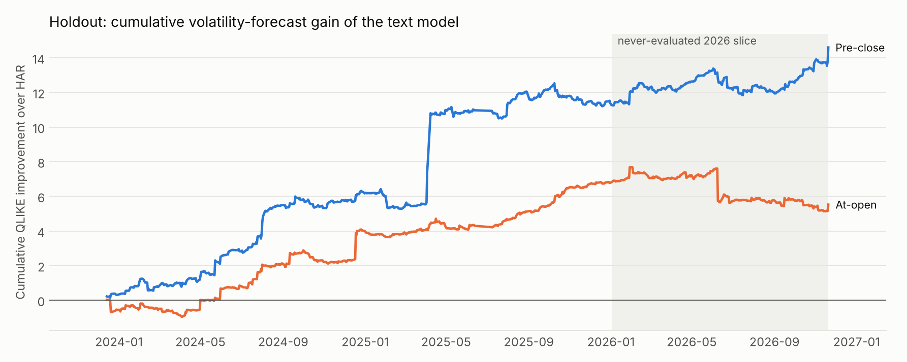

# Financial News and Daily Market VaR

Does financial news improve next-day risk forecasts for the S&P 500? This repository holds a reproducible pipeline that tests the question, two preregistered studies, and a working daily forecaster of volatility, Value-at-Risk (VaR) and expected shortfall (ES). It uses only free data and a CPU.

## Result

**A little, when done the right way.**

| | Study 1 | Study 2 |
|---|---|---|
| News signal | FinBERT sentiment averages | A ridge model that learns which headline words matter |
| Model | Quantile regression on 19 features | HAR volatility model, then VaR and ES |
| Preregistered result | No improvement | Volatility loss lower (one-sided p = 0.003); VaR/ES loss lower (one-sided p = 0.043) |

On 722 holdout sessions (December 2023 to November 2026) the text model lowered volatility forecast loss by 4.8% and 2.3% in the two forecast set-ups and VaR loss by about 1.5%.

Read the result with these caveats:

- **Small, and partly fragile.** The volatility result is robust to removing the most extreme month; the VaR/ES result is not.
- **Reused period.** About two-thirds of the holdout was the test period of study 1, whose null result prompted the second design.
- **Not yet confirmed on clean data.** On the 224 sessions of 2026, the only fully untouched data, the evidence is inconclusive.
- **Daily-data baseline.** The comparison model sees daily prices only, not intraday prices.
- **No human review.** The work and its reviews were done by AI agents.



Read the [PDF report](report/report.pdf) for the full account, or [docs/results.md](docs/results.md) for the tables.

## How it works

1. **Market data:** S&P 500 closes (FRED), VIX (Cboe), daily bars for the index and SPY (Yahoo).
2. **News:** GDELT page titles tagged with a stock-market theme and a US location, streamed from the public archive and verified batch by batch.
3. **Baseline:** a HAR model of range-based variance with VIX, refitted monthly.
4. **Text model:** a ridge regression of the baseline's error on the share of headlines containing each of 5,000 terms.
5. **VaR and ES:** the volatility forecast times the empirical tail of past standardized returns.
6. **Evaluation:** design on development data, independent review, preregistration, one evaluation of the holdout.

Two forecast set-ups are supported: 30 minutes before the previous close, and at the open.

## Quick start

Requires Python 3.12 and [uv](https://docs.astral.sh/uv/).

```bash
uv sync --locked
```

```bash
uv run pytest -q
```

```bash
uv run newsvar --help
```

Rebuilding the data takes about 9 hours on 4 CPUs; see [docs/reproduce.md](docs/reproduce.md). Once the data exist, a daily forecast is two commands:

```bash
uv run newsvar update
```

```bash
uv run newsvar forecast
```

## Documentation

| Document | Content |
|---|---|
| [report/report.pdf](report/report.pdf) | The full report: question, data, method, results, limits |
| [docs/results.md](docs/results.md) | Result tables and figures for both studies |
| [docs/methodology.md](docs/methodology.md) | Forecast set-ups, models, evaluation, preregistration |
| [docs/architecture.md](docs/architecture.md) | Pipeline, package layout, design rules, operations |
| [docs/reproduce.md](docs/reproduce.md) | Step-by-step commands |
| [docs/research-log.md](docs/research-log.md) | What was tried, in order, including reviewer findings |
| [docs/roadmap.md](docs/roadmap.md) | What the evidence lacks and what to do next |
| [docs/records/](docs/records/) | Preregistrations and machine-readable results |

## Repository layout

```text
src/newsvar/     pipeline code: data, nlp, features, volatility, models, evaluation, study
tests/           synthetic fixtures; no network or real data
scripts/         exploratory diagnostics
docs/            documentation, figures and result records
report/          LaTeX source and PDF of the report
```

## Data and rights

Raw data, news titles, scores, forecasts and model weights are never committed; they are rebuilt locally under `data/` and `.cache/`. GDELT, FRED, Cboe, Yahoo and the FinBERT weights each carry their own terms of use. Nothing here is investment advice.
