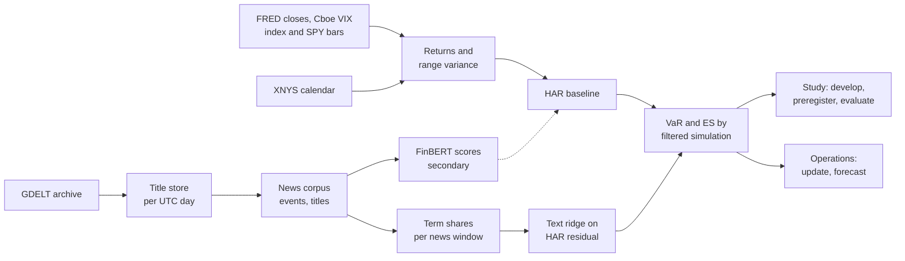

# Architecture

`newsvar` is a small batch pipeline. Each stage reads committed artifacts from the previous stage, writes its own artifact atomically, and can be rerun or resumed. There is no service, database server or scheduler.

## Pipeline



The same forecasting code serves the study and daily operation.

| Stage | Command | Writes (private, Git-ignored) |
|---|---|---|
| Market snapshot | `newsvar market fetch` | `data/raw/market/` |
| Calendar | `newsvar calendar build` | `data/calendars/<id>.json` |
| Market dataset | `newsvar market materialize` | `data/derived/market/<id>/` |
| GDELT catalog | `newsvar gdelt catalog` | `data/raw/gdelt/masterfilelist.txt` |
| Title extraction | `newsvar gdelt extract` | `data/raw/gdelt/titles/date=YYYY-MM-DD/` |
| Corpus | `newsvar news corpus` | `data/derived/news/<id>/` |
| Model files | `newsvar news fetch-model` | `.cache/models/ProsusAI_finbert/<revision>/` |
| Scoring | `newsvar news score` | `data/derived/scores/<fingerprint>/` |
| Bars | `newsvar market fetch-ohlc` | `data/raw/market/yahoo_*.json` |
| Volatility study | `newsvar vol develop / preregister / evaluate / report` | `data/derived/text_shares/`, `data/derived/study/` |
| Study 1 | `newsvar study admit / develop / preregister / evaluate / report` | `data/derived/features/<id>/`, `data/derived/study/` |
| Operations | `newsvar update`, `newsvar forecast` | `data/operations.json`, `data/forecasts/log.jsonl` |

Public, committed outputs are the JSON records in [records/](records/) and the figures in [figures/](figures/). They contain counts, hashes and aggregate scores only.

## Package layout

The package also has `__main__` so that `python -m newsvar` works.

| Package | Modules | Responsibility |
|---|---|---|
| `newsvar.data` | `calendar`, `market`, `labels`, `datasets`, `ohlc` | Exchange calendar and forecast origins; price sources; return labels; versioned market tables; daily bars |
| | `gdelt`, `news` | Streaming title extraction; normalization, relevance, deduplication, window assignment |
| `newsvar.nlp` | `encoder`, `scoring` | Pinned FinBERT loading; resumable bulk scoring |
| `newsvar.features` | `intervals`, `text_index` | News tone over any time interval and its surprise; headline term shares with a frozen vocabulary |
| | `definitions`, `table` | Study 1: the 19 feature formulas and the per-origin feature table |
| `newsvar.volatility` | `proxies`, `har`, `text_ridge`, `tail` | Range-based variance; log-HAR regression; ridge on HAR residuals with stacking; volatility-scaled VaR and ES |
| `newsvar.models` | `baselines`, `garch`, `quantile` | Study 1: historical simulation, EWMA, GARCH-t, penalized quantile regression |
| `newsvar.evaluation` | `metrics`, `inference` | Pinball loss, coverage tests, block bootstrap; QLIKE, FZ0, Diebold–Mariano, Giacomini–White, dynamic quantile |
| | `walkforward`, `experiments` | Study 1 walk-forward runners |
| `newsvar.study` | `volatility`, `volatility_report`, `operate` | Study 2 panel, forecasts, registration and evaluation; its tables and figures; operational forecasts |
| | `pipeline`, `report` | Study 1 stages and report |
| `newsvar` | `cli`, `doctor`, `hashing` | Command line; resource preflight; canonical JSON and SHA-256 |

Dependencies point one way: `study` → `evaluation` → `models`, `features` → `data`, `nlp`. Heavy libraries (PyTorch, scikit-learn, arch, matplotlib) are imported inside the functions that need them, so light commands start fast.

## Design rules

**Time is explicit.** Every forecast origin carries its cutoff (30 minutes before the scheduled close), issue deadline and target interval, built once from the exchange calendar. A news item belongs to the window `(previous cutoff, cutoff]` by its availability time. A market value or label is usable only if its recorded availability is at or before the cutoff. Tests cover the boundaries and check that changing future data cannot change an earlier row.

**Missing is not zero.** A GDELT batch that is absent or failed verification makes its window incomplete. Incomplete windows are excluded; they are never treated as "no news".

**Artifacts are content-addressed.** A dataset's directory name is the SHA-256 of its declared identity (inputs, rules, versions). Tables carry checksums that are verified on load. A changed rule produces a new directory instead of overwriting an old one.

**Writes are atomic and resumable.** Stages write to a staging path and rename. Extraction commits per day and scoring per 5,000 titles, so an interrupted run continues where it stopped.

**Gates are enforced in code.**
- `vol develop` drops every row after the development end before fitting.
- `vol preregister` refuses to run with uncommitted source changes. It records inputs by hash, source by content, every protocol constant and the eligible holdout row counts.
- `vol evaluate` requires the registration to be committed, compares every recorded value with the code and data, writes an "opened" marker before computing any outcome, and refuses a second run.
- The study 1 commands are weaker: `study preregister` needs a clean source tree and `study evaluate` checks the registration's hash and inputs and refuses to overwrite its output, but there is no opened marker and no source-content check.

**One code path for study and operation.** `forecast_all` produces every forecast. In study mode it forecasts only sessions with known outcomes so all models share one sample. In operations it also forecasts a session whose outcome is unknown, and an `as_of` time ensures that an unfinished session contributes no outcome.

**Raw text stays private.** Titles, prices and per-date forecasts live under `data/`. Nothing there is committed.

## Resource profile

Built for CPU and at most 8 GB of memory. `newsvar doctor --stage sentiment` checks the machine before heavy stages (5 GiB free RAM for scoring, 3 GiB for normalization, 15 GiB free disk).

| Stage | Measured on 4 CPUs, 15 GiB RAM |
|---|---|
| GDELT extraction, 2,641 days | about 3 h 15 min; 1.3 TiB streamed, 1.2 GiB kept |
| Corpus build | 4.5 min |
| FinBERT scoring, 1.15 million titles | about 5 h (not needed by the text model) |
| Term shares for 2,500 windows | 3 min |
| Development run, registration, holdout evaluation | about 3, 3 and 6 min |
| Daily `update` + `forecast` | about 5 + 5 min |

## Operations

```bash
uv run newsvar update
```

```bash
uv run newsvar forecast
```

**`update`** refreshes everything and then replaces `data/operations.json` atomically, so a failed update leaves the previous consistent state in use.

- Prices and bars go into a new dated directory, `data/raw/market/<timestamp>/`. Nothing a study settings file points to is overwritten.
- GDELT extraction checks every day against the current catalog. Batches already verified are reused; only batches that are new in the catalog or failed before are downloaded, so a network failure cannot replace verified data. Batches the archive answers with HTTP 404 are recorded as permanently missing.
- The corpus from the previous update is deleted unless a study settings file refers to it.

**`forecast`** considers the session that has not closed yet and the one after it. For each set-up it issues volatility, 95% and 99% VaR and ES from the baseline and the text model, but only when:

1. the set-up's information time has passed;
2. the data were refreshed after that time (`updated_at_utc` in the settings);
3. verified news batches reach the end of the news window.

Otherwise the set-up is reported as unavailable with the reason. A session counts as closed only relative to the data refresh time, so a partial price bar is never read as an outcome. Each record carries `timing`: `on_time` if it was issued before the target period (pre-close) or within 30 minutes of the open (at-open), else `late`. Records are appended to `data/forecasts/log.jsonl` and never rewritten.

A typical day: run both commands shortly after 15:30 New York time for the next session's pre-close forecast, and shortly after 09:30 for the at-open forecast. Each run takes about 10 minutes, so an at-open forecast issued at 09:45 is on time and a pre-close one issued at 15:45 is on time.

## Not built

- A scheduler: run the two commands from cron or a task scheduler.
- Continuous memory monitoring.
- Intraday prices in the baseline.

## Tests

`tests/` holds synthetic fixtures only: no network, no real prices, no real news. They cover calendar boundaries, label adjacency, baseline arithmetic, GARCH two-step simulation, batch verification and resume, deduplication causality, window assignment, feature eligibility, walk-forward chronology, coverage tests, the bootstrap, range variance, the HAR fit, the loss functions and tests, the text model's stacking rule, registration checks, and perturbation tests showing that outcomes and text dated after a forecast's information time cannot change it.
