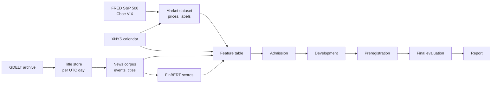

# Architecture

`newsvar` is a small batch pipeline. Each stage reads committed artifacts from the previous stage, writes its own artifact atomically, and can be rerun or resumed. There is no service, database server or scheduler.

## Pipeline

| Stage | Command | Writes (private, Git-ignored) |
|---|---|---|
| Market snapshot | `newsvar market fetch` | `data/raw/market/` |
| Calendar | `newsvar calendar build` | `data/calendars/<id>.json` |
| Market dataset | `newsvar market materialize` | `data/derived/market/<id>/` |
| GDELT catalog | `newsvar gdelt catalog` | `data/raw/gdelt/masterfilelist.txt` |
| Title extraction | `newsvar gdelt extract` | `data/raw/gdelt/titles/date=YYYY-MM-DD/` |
| Corpus | `newsvar news corpus` | `data/derived/news/<id>/` |
| Model files | `newsvar news fetch-model` | `.cache/models/ProsusAI_finbert/<revision>/` |
| Scoring | `newsvar news score` | `data/derived/scores/<fingerprint>/` |
| Study stages | `newsvar study admit / develop / preregister / evaluate / report` | `data/derived/features/<id>/`, `data/derived/study/` |

Public, committed outputs are the JSON records in [records/](records/) and the figures in [figures/](figures/). They contain counts, hashes and aggregate scores only.

## Package layout

| Package | Modules | Responsibility |
|---|---|---|
| `newsvar.data` | `calendar`, `market`, `labels`, `datasets` | Exchange calendar and forecast origins; price sources; return labels; versioned market tables |
| | `gdelt`, `news` | Streaming title extraction; normalization, relevance, deduplication, window assignment |
| `newsvar.nlp` | `encoder`, `scoring` | Pinned FinBERT loading; resumable bulk scoring |
| `newsvar.features` | `definitions`, `table` | The 19 feature formulas; the per-origin feature table and eligibility |
| `newsvar.models` | `baselines`, `garch`, `quantile` | Historical simulation and EWMA; GARCH-t and filtered historical simulation; penalized linear quantile regression |
| `newsvar.evaluation` | `metrics`, `walkforward`, `experiments` | Pinball loss, coverage tests, block bootstrap; baseline walk-forward; quantile-model walk-forward and paired comparisons |
| `newsvar.study` | `pipeline`, `report` | Admission, development, preregistration, final evaluation; tables and figures |
| `newsvar` | `cli`, `doctor`, `hashing` | Command line; resource preflight; canonical JSON and SHA-256 |

Dependencies point one way: `study` → `evaluation` → `models`, `features` → `data`, `nlp`. Heavy libraries (PyTorch, scikit-learn, arch, matplotlib) are imported inside the functions that need them, so light commands start fast.

## Design rules

**Time is explicit.** Every forecast origin carries its cutoff (30 minutes before the scheduled close), issue deadline and target interval, built once from the exchange calendar. A news item belongs to the window `(previous cutoff, cutoff]` by its availability time. A market value or label is usable only if its recorded availability is at or before the cutoff. Tests cover the boundaries and check that changing future data cannot change an earlier row.

**Missing is not zero.** A GDELT batch that is absent or failed verification makes its window incomplete. Incomplete windows are excluded; they are never treated as "no news".

**Artifacts are content-addressed.** A dataset's directory name is the SHA-256 of its declared identity (inputs, rules, versions). Tables carry checksums that are verified on load. A changed rule produces a new directory instead of overwriting an old one.

**Writes are atomic and resumable.** Stages write to a staging path and rename. Extraction commits per day and scoring per 5,000 titles, so an interrupted run continues where it stopped.

**Gates are enforced in code.**
- `study develop` computes nothing outside the development range.
- `study preregister` refuses to run with uncommitted source changes and records the commit and lockfile hash.
- `study evaluate` refuses to run if the inputs differ from the preregistration or a final record already exists.

**Raw text stays private.** Titles, prices and per-date forecasts live under `data/`. Nothing there is committed.

## Resource profile

Built for CPU and at most 8 GB of memory. `newsvar doctor --stage sentiment` checks the machine before heavy stages (5 GiB free RAM for scoring, 3 GiB for normalization, 15 GiB free disk).

| Stage | Measured on 4 CPUs, 15 GiB RAM |
|---|---|
| GDELT extraction, 2,314 days | 2 h 50 min; 1.13 TiB streamed, 1.1 GiB kept |
| Corpus build | 3 min |
| FinBERT scoring, 967,729 titles | 3 h 50 min |
| Admission, development, final evaluation | under 10 min in total |

## Not built

Scheduled daily forecasts, continuous memory monitoring, and a prospective log of news arrival times. The study found no benefit from news, so no model was promoted to daily use.

## Tests

`tests/` holds synthetic fixtures only: no network, no real prices, no real news. They cover calendar boundaries, label adjacency, baseline arithmetic, GARCH two-step simulation, batch verification and resume, deduplication causality, window assignment, feature eligibility, walk-forward chronology, coverage tests and the bootstrap.
