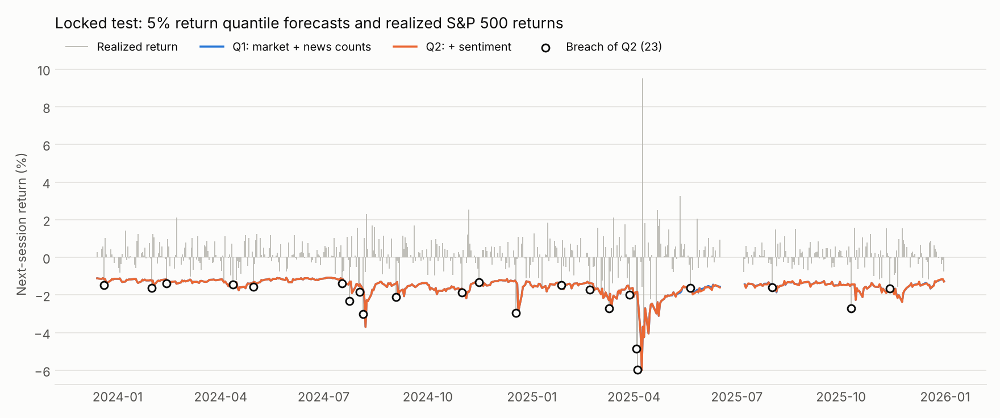
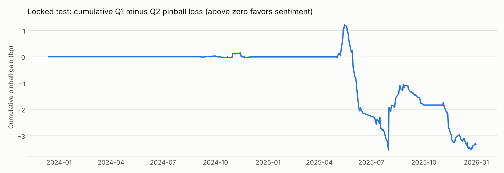

# Generated result tables

Generated by `newsvar study report` from the admission, development and final records. Scores are mean pinball losses in basis points of return (decimal loss x 10,000). A positive improvement favors the challenger.

- Preregistration: `9a49621af268c5578beec9866ffd02622ef9a421e10a5004ab3dd14aa9c5cd53`
- Design: `reduced_study`; usable rows 1441 (training 691, development 250, test 500)
- Development target-end range: 2022-12-13 to 2023-12-13
- Test target-end range: 2023-12-14 to 2025-12-31; eligible forecasts 500

## Primary comparison (Q2 vs Q1, 5% tail, locked test)

- Mean improvement: -0.0066 bp; relative gain -0.06%
- 95% block-bootstrap interval (block 20): [-0.0222, 0.0058] bp
- Preregistered claim supported: **no**

## Locked test, 5% tail

### Calibration

| Model | Forecasts | Breaches (expected) | Breach rate | Mean pinball (bp) | Kupiec p | Independence p | Longest run |
|---|---:|---:|---:|---:|---:|---:|---:|
| Q0 market | 500 | 23 (25.0) | 4.60% | 11.340 | 0.678 | 0.391 | 2 |
| Q1 market + news counts | 500 | 23 (25.0) | 4.60% | 11.315 | 0.678 | 0.391 | 2 |
| Q2 market + counts + sentiment | 500 | 23 (25.0) | 4.60% | 11.322 | 0.678 | 0.391 | 2 |
| T0 tree, market | 500 | 28 (25.0) | 5.60% | 11.672 | 0.546 | 0.279 | 2 |
| T1 tree, + counts | 500 | 29 (25.0) | 5.80% | 11.513 | 0.423 | 0.102 | 2 |
| T2 tree, + sentiment | 500 | 29 (25.0) | 5.80% | 11.251 | 0.423 | 0.806 | 2 |
| B3 filtered historical simulation | 500 | 26 (25.0) | 5.20% | 11.910 | 0.838 | 0.586 | 2 |
| B2 GARCH-t | 500 | 26 (25.0) | 5.20% | 11.890 | 0.838 | 0.586 | 2 |
| B1 Gaussian EWMA | 500 | 30 (25.0) | 6.00% | 12.173 | 0.319 | 0.128 | 3 |
| B0 historical simulation (250) | 500 | 30 (25.0) | 6.00% | 12.179 | 0.319 | 0.385 | 3 |

### Paired comparisons

| Comparison (challenger vs baseline) | Pairs | Baseline (bp) | Challenger (bp) | Improvement (bp) | Relative gain | 95% interval, block 20 (bp) |
|---|---:|---:|---:|---:|---:|---|
| Q0 vs strongest baseline | 500 | 11.890 | 11.340 | 0.5499 | 4.62% | [-0.1405, 1.4459] |
| Q0 with vix vs without | 500 | 11.677 | 11.340 | 0.3368 | 2.88% | [-0.0757, 0.7760] |
| Q1 vs Q0 | 500 | 11.340 | 11.315 | 0.0247 | 0.22% | [0.0013, 0.0464] |
| Q2 vs Q0 | 500 | 11.340 | 11.322 | 0.0180 | 0.16% | [-0.0079, 0.0410] |
| Q2 vs Q1 | 500 | 11.315 | 11.322 | -0.0066 | -0.06% | [-0.0222, 0.0058] |
| Q2 vs strongest baseline | 500 | 11.890 | 11.322 | 0.5679 | 4.78% | [-0.1280, 1.4737] |
| T2 vs Q2 | 500 | 11.322 | 11.251 | 0.0708 | 0.63% | [-0.6774, 0.9896] |
| T2 vs T1 | 500 | 11.513 | 11.251 | 0.2619 | 2.27% | [-0.3599, 1.1710] |

Q2 vs Q1 by target year (bp): 2023: -0.0000 (11 pairs), 2024: -0.0000 (252 pairs), 2025: -0.0140 (237 pairs)

## Locked test, 1% (exploratory; few expected breaches) tail

### Calibration

| Model | Forecasts | Breaches (expected) | Breach rate | Mean pinball (bp) | Kupiec p | Independence p | Longest run |
|---|---:|---:|---:|---:|---:|---:|---:|
| Q0 market | 500 | 9 (5.0) | 1.80% | 3.826 | 0.106 | 0.145 | 2 |
| Q1 market + news counts | 500 | 9 (5.0) | 1.80% | 3.813 | 0.106 | 0.145 | 2 |
| Q2 market + counts + sentiment | 500 | 9 (5.0) | 1.80% | 3.669 | 0.106 | 0.145 | 2 |
| T0 tree, market | 500 | 8 (5.0) | 1.60% | 4.246 | 0.215 | 0.110 | 2 |
| T1 tree, + counts | 500 | 6 (5.0) | 1.20% | 4.194 | 0.663 | 0.054 | 2 |
| T2 tree, + sentiment | 500 | 9 (5.0) | 1.80% | 3.836 | 0.106 | 0.145 | 2 |
| B3 filtered historical simulation | 500 | 6 (5.0) | 1.20% | 4.274 | 0.663 | 0.054 | 2 |
| B2 GARCH-t | 500 | 9 (5.0) | 1.80% | 4.247 | 0.106 | 0.145 | 2 |
| B1 Gaussian EWMA | 500 | 12 (5.0) | 2.40% | 4.497 | 0.008 | 0.284 | 2 |
| B0 historical simulation (250) | 500 | 10 (5.0) | 2.00% | 4.511 | 0.048 | 0.012 | 2 |

### Paired comparisons

| Comparison (challenger vs baseline) | Pairs | Baseline (bp) | Challenger (bp) | Improvement (bp) | Relative gain | 95% interval, block 20 (bp) |
|---|---:|---:|---:|---:|---:|---|
| Q0 vs strongest baseline | 500 | 4.497 | 3.826 | 0.6715 | 14.93% | [0.0988, 1.4179] |
| Q0 with vix vs without | 500 | 4.143 | 3.826 | 0.3170 | 7.65% | [0.1090, 0.4699] |
| Q1 vs Q0 | 500 | 3.826 | 3.813 | 0.0128 | 0.33% | [-0.0494, 0.0531] |
| Q2 vs Q0 | 500 | 3.826 | 3.669 | 0.1566 | 4.09% | [-0.2093, 0.6747] |
| Q2 vs Q1 | 500 | 3.813 | 3.669 | 0.1438 | 3.77% | [-0.2096, 0.6530] |
| Q2 vs strongest baseline | 500 | 4.497 | 3.669 | 0.8281 | 18.41% | [0.0043, 1.9313] |
| T2 vs Q2 | 500 | 3.669 | 3.836 | -0.1669 | -4.55% | [-0.9598, 0.3442] |
| T2 vs T1 | 500 | 4.194 | 3.836 | 0.3574 | 8.52% | [0.0616, 0.7451] |

Q2 vs Q1 by target year (bp): 2023: -0.1734 (11 pairs), 2024: -0.0316 (252 pairs), 2025: 0.3451 (237 pairs)

## Locked test, 5% tail: sensitivities

| Sensitivity (rebuilt and refitted) | Eligible forecasts | Q2 vs Q1 relative gain | 95% interval, block 20 (bp) | Q1 vs Q0 relative gain |
|---|---:|---:|---|---:|
| availability buffer 240min | 500 | -0.01% | [-0.0088, 0.0072] | 0.18% |
| availability buffer 60min | 500 | 0.02% | [-0.0108, 0.0171] | 0.24% |
| counts include duplicates | 500 | -0.07% | [-0.0227, 0.0001] | 0.11% |
| dominant source excluded | 500 | -0.03% | [-0.0185, 0.0075] | 0.21% |
| news delayed one session | 500 | 0.00% | [-0.0000, 0.0000] | 0.00% |
| recap headlines excluded | 500 | 0.02% | [-0.0618, 0.0752] | 0.24% |
| sentiment lagged 20 origins | 487 | -0.15% | [-0.0475, 0.0000] | 0.16% |
| sentiment lagged 5 origins | 495 | 0.00% | [0.0000, 0.0000] | 0.21% |

Q2 vs Q1 by ex-ante volatility regime (training-period terciles of lagged 21-session volatility), bp: high: 0.0183 (63 pairs), low: -0.0025 (283 pairs), middle: -0.0244 (154 pairs)

Quantile crossings (1% above 5%): Q0: 0/500, Q1: 0/500, Q2: 10/500

## Development range (used for selection only)

Selected L1 penalties: `{'0.01': {'Q0': 0.001, 'Q1': 0.001, 'Q2': 0.001}, '0.05': {'Q0': 0.01, 'Q1': 0.01, 'Q2': 0.01}}`. Strongest baseline: `{'0.01': 'gaussian_ewma_d0.94_i63', '0.05': 'garch_t'}`.

### 5% tail calibration

| Model | Forecasts | Breaches (expected) | Breach rate | Mean pinball (bp) | Kupiec p | Independence p | Longest run |
|---|---:|---:|---:|---:|---:|---:|---:|
| Q0 market | 250 | 5 (12.5) | 2.00% | 8.762 | 0.014 | 0.650 | 1 |
| Q1 market + news counts | 250 | 5 (12.5) | 2.00% | 9.174 | 0.014 | 0.650 | 1 |
| Q2 market + counts + sentiment | 250 | 5 (12.5) | 2.00% | 9.127 | 0.014 | 0.650 | 1 |
| B3 filtered historical simulation | 250 | 11 (12.5) | 4.40% | 8.897 | 0.657 | 0.312 | 1 |
| B2 GARCH-t | 250 | 13 (12.5) | 5.20% | 8.851 | 0.885 | 0.230 | 1 |
| B1 Gaussian EWMA | 250 | 13 (12.5) | 5.20% | 8.902 | 0.885 | 0.230 | 1 |
| B0 historical simulation (250) | 250 | 1 (12.5) | 0.40% | 10.466 | 0.000 | 0.928 | 1 |

### 5% tail paired comparisons

| Comparison (challenger vs baseline) | Pairs | Baseline (bp) | Challenger (bp) | Improvement (bp) | Relative gain | 95% interval, block 20 (bp) |
|---|---:|---:|---:|---:|---:|---|
| Q0 vs strongest baseline | 250 | 8.851 | 8.762 | 0.0889 | 1.00% | [-0.4340, 0.6409] |
| Q0 with vix vs without | 250 | 9.649 | 8.762 | 0.8871 | 9.19% | [0.5426, 1.2196] |
| Q1 vs Q0 | 250 | 8.762 | 9.174 | -0.4123 | -4.71% | [-0.7655, -0.1696] |
| Q2 vs Q0 | 250 | 8.762 | 9.127 | -0.3652 | -4.17% | [-0.6814, -0.1585] |
| Q2 vs Q1 | 250 | 9.174 | 9.127 | 0.0471 | 0.51% | [-0.0117, 0.1250] |
| Q2 vs strongest baseline | 250 | 8.851 | 9.127 | -0.2763 | -3.12% | [-0.9859, 0.3456] |

### 5% tail sensitivities

| Sensitivity (rebuilt and refitted) | Eligible forecasts | Q2 vs Q1 relative gain | 95% interval, block 20 (bp) | Q1 vs Q0 relative gain |
|---|---:|---:|---|---:|
| availability buffer 240min | 250 | 0.05% | [-0.0268, 0.0653] | -4.22% |
| availability buffer 60min | 250 | 0.16% | [-0.0037, 0.0547] | -4.54% |
| counts include duplicates | 250 | -1.73% | [-0.2492, -0.0706] | -2.20% |
| dominant source excluded | 250 | 0.24% | [-0.0255, 0.0850] | -4.90% |
| news delayed one session | 250 | -0.57% | [-0.0831, -0.0214] | -0.18% |
| recap headlines excluded | 250 | 0.22% | [-0.0995, 0.1416] | -4.66% |
| sentiment lagged 20 origins | 247 | -0.63% | [-0.2463, 0.0663] | -3.59% |
| sentiment lagged 5 origins | 248 | -0.31% | [-0.0859, 0.0117] | -4.35% |
