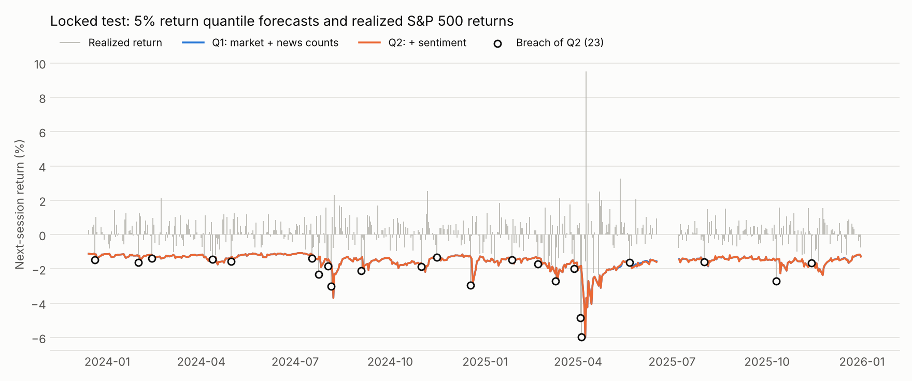
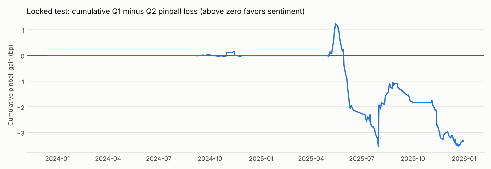

# Results of study 1: sentiment in a quantile regression

**News sentiment did not improve the VaR forecast.** The preregistered claim is not supported.

The test covers 500 forecasts with target dates from 2023-12-14 to 2025-12-31. Scores are mean pinball loss in basis points (bp) of return; lower is better. Method details are in [methodology.md](methodology-study1.md); complete tables are in [records/result_tables.md](records/result_tables.md).

## Primary comparison

Q2 (market + news counts + sentiment) against Q1 (market + news counts), 5% tail.

| Measure | Value |
|---|---|
| Q1 mean pinball loss | 11.315 bp |
| Q2 mean pinball loss | 11.322 bp |
| Improvement from sentiment | −0.0066 bp (−0.06%) |
| 95% interval, block 20 | −0.0222 to +0.0058 bp |
| 95% interval, blocks 10 and 5 | −0.0203 to +0.0054; −0.0178 to +0.0039 bp |
| Claim supported | No |

The two models produce almost the same forecasts. At the penalty chosen in development, the regression gives the sentiment features almost no weight.

## All models, 5% tail

| Model | Breaches (25 expected) | Mean pinball loss (bp) | Coverage test p |
|---|---:|---:|---:|
| Q0 market | 23 | 11.340 | 0.68 |
| Q1 + news counts | 23 | 11.315 | 0.68 |
| Q2 + sentiment | 23 | 11.322 | 0.68 |
| T2 tree with sentiment | 29 | 11.251 | 0.42 |
| T1 tree with counts | 29 | 11.513 | 0.42 |
| T0 tree, market | 28 | 11.672 | 0.55 |
| B2 GARCH-t | 26 | 11.890 | 0.84 |
| B3 filtered historical simulation | 26 | 11.910 | 0.84 |
| B1 Gaussian EWMA | 30 | 12.173 | 0.32 |
| B0 historical simulation | 30 | 12.179 | 0.32 |

Every model is acceptably calibrated; no independence test rejects.

## Secondary comparisons (exploratory)

| Comparison, 5% tail | Relative gain | 95% interval (bp) |
|---|---:|---|
| News counts: Q1 vs Q0 | +0.22% | +0.001 to +0.046 |
| Counts and sentiment: Q2 vs Q0 | +0.16% | −0.008 to +0.041 |
| Quantile regression vs GARCH-t: Q0 vs B2 | +4.62% | −0.141 to +1.446 |
| VIX features: Q0 with vs without | +2.88% | −0.076 to +0.776 |
| Trees: T2 vs T1 | +2.27% | −0.360 to +1.171 |

- The news-count gain is tiny, and in development it had the opposite sign (−4.7%). It is not a finding.
- The market-only quantile regression beat GARCH-t by 4.6%, but the interval includes zero.

## 1% tail (exploratory)

Five breaches were expected; Q0, Q1 and Q2 each had nine. Q2 against Q1 gained 3.8%, with an interval from −0.21 to +0.65 bp. Q2's 1% quantile crossed above its 5% quantile on 10 of 500 days.

## Sensitivities

Each row rebuilds the features and refits the models. Q2 against Q1, 5% tail.

| Variant | Relative gain |
|---|---:|
| News available 60 minutes after batch time | +0.02% |
| News available 240 minutes after batch time | −0.01% |
| News delayed one full session | 0.00% |
| Sentiment lagged 5 sessions | 0.00% |
| Sentiment lagged 20 sessions | −0.15% |
| Market-recap headlines removed | +0.02% |
| Largest publisher removed | −0.03% |
| Counts include duplicates | −0.07% |

Every interval includes zero. By volatility regime: calm −0.003 bp (283 days), middle −0.024 bp (154), turbulent +0.018 bp (63).

## Development period

On the 250 development forecasts (2023), sentiment added 0.5% over counts (interval includes zero), counts made the model 4.7% worse, and VIX improved the market model by 9.2%. The quantile models were too conservative there: 5 breaches against 12.5 expected, because they were trained mostly on the more volatile 2020–2022 period.

## What this does and does not show

It shows that tone aggregates from a broad feed of GDELT page titles, scored with a 2020 FinBERT, did not improve a regularized linear 5% VaR forecast for the S&P 500 in 2024–2025.

It does not show that financial news carries no risk information. The test has low power, the feed is noisy, sentiment was sampled, and timing is a proxy. A diagnostic on the training and development data found a small but statistically visible link between negative tone and next-day volatility; see [methodology.md](methodology.md).

The 2023-12-14 to 2025-12-31 period is now used up as a confirmatory test for this design.

## Records

| Record | Content |
|---|---|
| [gdelt_extraction](records/gdelt_extraction_20261124.json) | Batches verified, absent and failed |
| [news_corpus](records/news_corpus_20261124.json) | Corpus counts and table checksums |
| [market_snapshot](records/market_snapshot_20261124.json) | Price file sizes and hashes |
| [news_admission](records/news_admission_20261124.json) | Window completeness, eligible rows, split |
| [development_record](records/development_record_20261124.json) | All 42 development runs and sensitivities |
| [preregistration](records/preregistration_20261124.json) | Frozen protocol |
| [final_evaluation](records/final_evaluation_20261124.json) | Test-period scores and comparisons |
