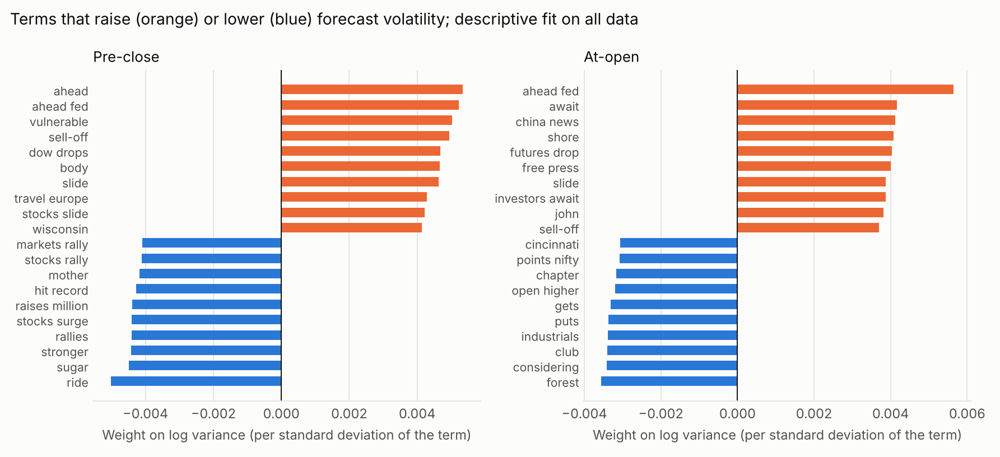
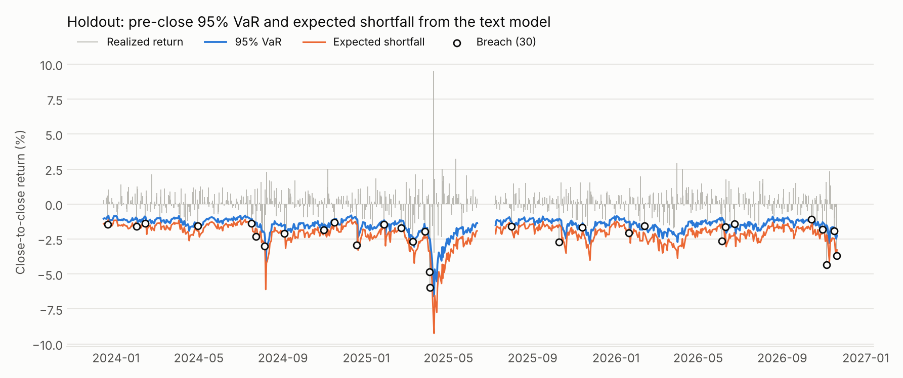

# Results

Two preregistered studies asked whether financial news improves next-day risk forecasts for the S&P 500.

| | Study 1 | Study 2 |
|---|---|---|
| News signal | FinBERT sentiment averages | Ridge model of headline terms |
| Model | 19-feature quantile regression | HAR volatility model, then VaR and ES |
| Test | 500 sessions, Dec 2023 – Dec 2025 | 722 sessions, Dec 2023 – Nov 2026 |
| Primary result | −0.06% change in 5% quantile loss | Pooled volatility loss lower, one-sided p = 0.003 |
| Registered outcome | Not supported | Both registered hypotheses passed |

**Bottom line.** News helps a little when the model learns which headline words matter and the target is volatility. Generic sentiment does not help. The gain is small: 2–5% in volatility loss and about 1.5% in VaR loss.

Three caveats belong with that sentence:

- About two-thirds of the holdout (December 2023 to December 2025) was the test period of study 1, whose null result prompted this design.
- The baseline uses daily prices only.
- On the 224 sessions of 2026, the only fully untouched data, the evidence is inconclusive.

The full write-up is the [PDF report](../report/report.pdf). Study 1 is detailed in [results-study1.md](results-study1.md). Method: [methodology.md](methodology.md).

## Study 2: primary test

Holdout: 2023-12-14 to 2026-11-20. The text model is compared with the HAR baseline; the test averages the two forecast set-ups' daily improvements.

| Hypothesis | Loss | Sessions | t | One-sided p | Passed |
|---|---|---:|---:|---:|---|
| H1 (primary) | QLIKE, volatility | 722 | 2.75 | 0.003 | yes |
| H2 (key secondary) | FZ0, 5% VaR and ES jointly | 722 | 1.72 | 0.043 | yes, narrowly |
| supporting | Pinball, 5% VaR | 722 | 2.55 | 0.005 | |

- The registered rule labels this outcome "strong" because both hypotheses passed. The label names the rule; it is not an effect size.
- For H1, each set-up also passes alone after Holm correction (p = 0.010 pre-close, 0.045 at-open).
- H2 passes at a one-sided 5% level only; two-sided, p = 0.086.
- Only H1 and H2 were registered as tests. Every other t and p on this page is unadjusted and exploratory.

## By forecast set-up

| | Pre-close (722 sessions) | | At-open (724 sessions) | |
|---|---:|---:|---:|---:|
| | Baseline | Text model | Baseline | Text model |
| QLIKE | 0.4180 | 0.3978 | 0.3274 | 0.3198 |
| 5% pinball loss (bp) | 11.39 | 11.22 | 9.00 | 8.89 |
| 5% breaches (36 expected) | 27 | 30 | 34 | 33 |
| 1% breaches (7.2 expected) | 8 | 8 | 7 | 8 |
| Coverage test p, 5% | 0.10 | 0.28 | 0.70 | 0.58 |
| **QLIKE gain from text** | | **+4.8%** (t = 2.58) | | **+2.3%** (t = 1.69) |
| **5% pinball gain from text** | | **+1.5%** (t = 1.98) | | **+1.3%** (t = 2.46) |

Coverage: the Kupiec test does not reject 5% coverage for the baseline or the text model. The dynamic-quantile test, which also checks clustering, does not reject at 5% but rejects both at the 1% level in the pre-close set-up (p = 0.006 and 0.013).

For scale, the baseline's 5% pinball loss is 4.7% (pre-close) and 9.9% (at-open) lower than 250-day historical simulation. On this holdout those differences are not significant on their own (t = 1.3 and 1.5); on development data they were (t = 2.1 and 2.9). Historical simulation has 15 breaches at the 1% level against 7.2 expected. Most of the accuracy comes from the volatility model; news adds a small step.

## The never-evaluated 2026 slice

The 224 sessions of 2026 had never been evaluated in any form before this test.

| 2026 only | Pre-close | At-open | Pooled |
|---|---:|---:|---:|
| QLIKE gain from text | +4.3% (t = 1.72) | −1.7% (t = −0.58) | t = 0.55, p = 0.29 |
| 5% pinball gain from text | +1.8% (t = 1.15) | +1.6% (t = 2.01) | t = 1.68, p = 0.047 |
| 5% FZ0 improvement | | | t = 0.86, p = 0.19 |

This is the cleanest evidence and it is inconclusive.

- The pooled volatility gain is not significant, and it comes from two days (2026-01-29 and 2026-11-20); without them the mean is slightly negative (t = −0.17).
- At the open, the text model's volatility forecasts are worse than the baseline's in 2026.
- The pooled pinball gain is nominally significant (unadjusted); the registered joint VaR/ES loss is not.

With 224 sessions the slice neither contradicts nor independently confirms the main result.

## Which news signal matters

| News term added to the baseline | Pre-close QLIKE gain | At-open QLIKE gain | Status |
|---|---:|---:|---|
| Text model | +4.8% (t = 2.58) | +2.3% (t = 1.69; interval includes zero) | registered hypothesis |
| News-count surprise | +1.9% (t = 2.08) | +1.9% (t = 2.62) | exploratory; intervals exclude zero, but almost no VaR gain |
| FinBERT negative share | +2.6% (t = 1.06) | +0.4% | exploratory |
| FinBERT negative-share surprise | +1.9% (t = 0.92) | −0.2% | exploratory |
| FinBERT mean-negative surprise | +2.0% (t = 0.98) | −0.2% | exploratory |

Many of the largest weights are sensible ("ahead fed", "sell-off", "futures drop" raise the forecast; "stocks rally", "hit record" lower it). Others are noise from an unfiltered web feed.

## Robustness (run after the evaluation; descriptive)

- **H1 does not rest on one episode.** April 2025 supplies 28% of the pooled QLIKE gain; without that month the test still gives t = 2.67.
- **H1 is concentrated in few days.** The best seven days (1%) supply 53% of the net pooled QLIKE gain. Removing the seven best and seven worst gives t = 4.27. The at-open gain is the fragile part: its seven best days supply 88% of its net gain, and without them t = 0.26.
- **H2 is fragile.** Without April 2025 the pooled FZ0 test gives t = 1.37 (p = 0.085); without the single best day, t = 1.60 (p = 0.055). Two of the three registered bootstrap intervals for FZ0 include zero, and neither set-up is significant alone.
- **Conditional test.** It rejects equal conditional accuracy in both set-ups (p = 0.004 and 0.028). The statistic includes the unconditional mean, so this is not separate evidence that the gain varies with market conditions.
- **Not just that day's market move.** On development data, giving the pre-close baseline the same-day variance and VIX (which it cannot have in practice) left the volatility gain at +3.4% (t = 3.3); the VaR gain shrank from +2.2% to +0.6%. Script: [`scripts/oracle_diagnostic.py`](../scripts/oracle_diagnostic.py).

## Limits

1. **Small and partly fragile effect.** The volatility result (H1) survives the robustness checks. The VaR/ES result (H2) and the at-open volatility gain do not survive all of them.
2. **Part of the holdout was used before.** December 2023 to December 2025 was study 1's test period, and study 1's failure prompted this design. No volatility or text model had been evaluated there, but the design is not blind to that period.
3. **Daily-data baseline.** The result shows news text improves a model built from daily prices. It does not show that news beats intraday prices, which were not available.
4. **Noisy source.** GDELT page titles. In an audit of 200 titles from 2019–2022, chosen in equal numbers by FinBERT label rather than at random, about one in seven was off-topic. The project's AI agent rated them, not a human, and the individual ratings were not archived.
5. **Proxy timestamps.** News is dated by GDELT's 15-minute batch plus 15 minutes.
6. **Development choices.** Five news terms, two penalty grids, two feature forms and two price sources were compared on development data. All are in the [research log](research-log.md). The penalty grid changes the pre-close development result noticeably.
7. **The 1% tail** is not significantly improved by news.
8. **Many comparisons.** Apart from H1 and H2, nothing here is adjusted for multiple testing.
9. **No human review.** The work, the audit and all four reviews were done by AI agents.

## Records

| Record | Content |
|---|---|
| [volatility_preregistration](records/volatility_preregistration_20261124.json) | Frozen protocol, hypotheses, disclosures |
| [volatility_evaluation](records/volatility_evaluation_3f5a032a19e2.json) | Holdout results |
| [volatility_summary](records/volatility_summary_3f5a032a19e2.json) | Slice tests and term weights |
| [volatility_result_tables](records/volatility_result_tables.md) | All tables, generated |
| [volatility_development](records/volatility_development_20261124.json) | Development-period results |
| Study 1 records | Listed in [results-study1.md](results-study1.md) |
